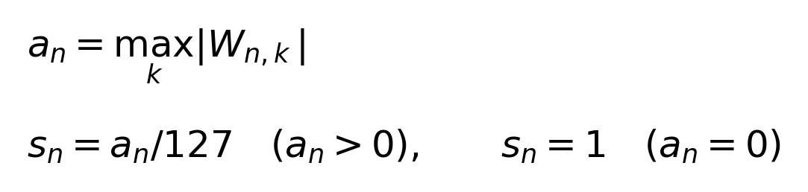
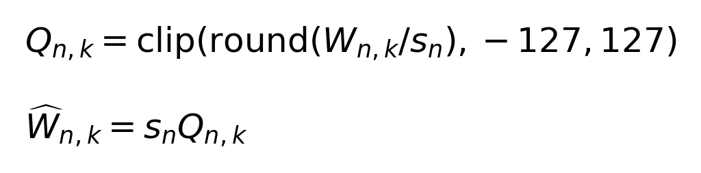
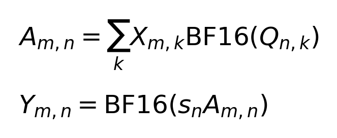
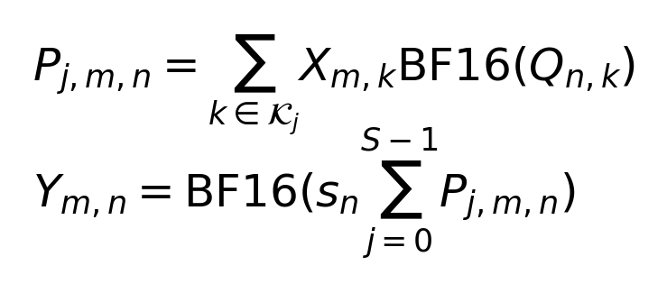
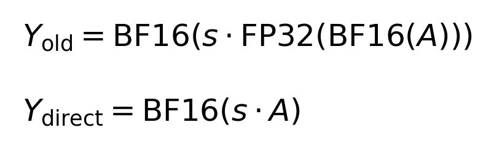
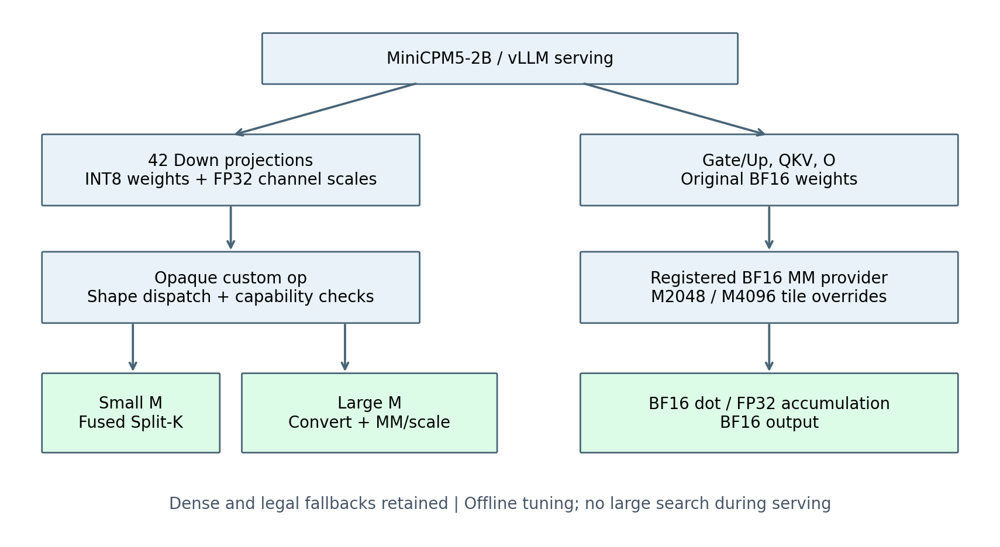
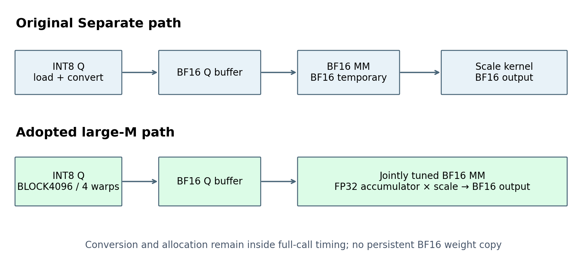
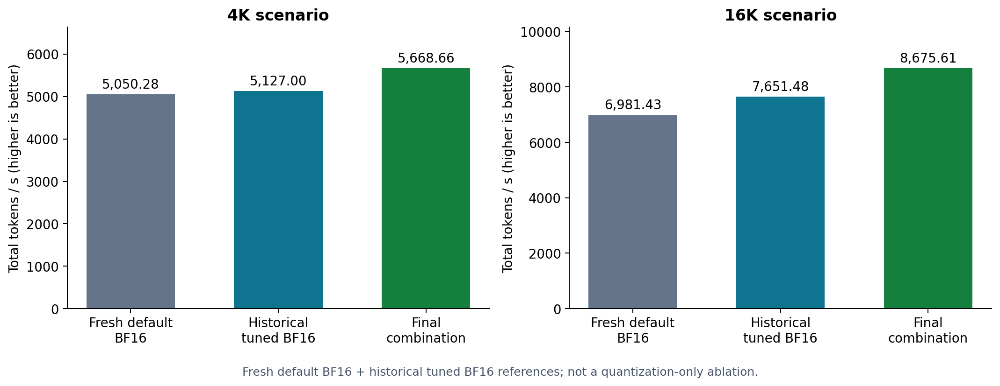

# 面向 MiniCPM5-2B 的 W8A16 权重量化与 GEMM 协同优化

> 量化专项技术报告｜MetaX C500｜2026-11-12｜团队整合稿
> 对应实现：`muxifinal` 分支。本文供团队整合最终技术报告，重点说明量化部分的设计、实现与验证。002/003 仅作为关联优化引用，原生 BF16 MM 底层实现沿用团队提供者。**已补入最终组合新测精度：0.9714（102/105正确）；两条长度封顶输出及验证边界在精度分析中说明。**

## 摘要

本方案面向 MiniCPM5-2B 在沐曦 MetaX C500 上的推理，研究静态、对称、逐输出通道的 W8A16 权重量化及配套 GEMM 执行路径。权重以 INT8 保存，激活保持 BF16，计算时将 INT8 转为 BF16，通过 BF16 dot 和 FP32 累加完成矩阵乘法，输出 BF16。方案不依赖原生 INT8×INT8 矩阵乘法，也不通过官方启动参数开启现成量化功能，而是在插件权重加载、算子分发和 FlagGems Kernel 中实现量化计算链路。

设计的核心问题是：**权重压缩减少的存储与访存，能否抵消运行时转换、额外 Kernel、workspace 与低利用率带来的成本。** 为此，方案将投影选择、算法选择和配置选择结合起来：先按真实 Shape 比较不同投影，再保留具有实际收益依据的 Down-only 组合；小 M 使用融合 Split-K，大 M 使用转换与 BF16 MM/scale epilogue 融合；保留 Fused Dense 和合法回退，并通过离线配置、版本指纹与实际运行路径核对保证选择可追溯。

针对大 M，进一步优化 INT8→BF16 转换粒度，将 scale 移入 MM 的 FP32 累加输出阶段，并在这一固定新路径上重新选择分块。实际接入的 Down M2048 完整调用由原专用配置的 445.27 μs 降为 352.90 μs，M4096 由 850.65 μs 降为 564.01 μs；这些是同场算子结果，不等同模型吞吐收益。包含量化、BF16 专用配置及团队 002/003 的最终组合已完成官方性能流程：4K 为 5668.66 total tokens/s，16K 为 8675.61 total tokens/s。该结果用于展示最终组合效果，不作为量化单项收益。

## 1. 任务目标与贡献边界

### 1.1 优化目标

赛事性能指标为 `total tokens/s`，同时关注 TTFT 约束与模型能力。正式测试负载如下：

| 场景 | 输入长度 | 输出长度 | 并发 | 每轮请求数 |
|---|---:|---:|---:|---:|
| 4K | 4096 | 1024 | 64 | 256 |
| 16K | 16384 | 1024 | 64 | 128 |

本文复用已有 GEMM 热点分析，不重新扩展到其他模块的瓶颈研究。量化优化必须在完整调用中计入转换、workspace、输出分配、归约和 scale，最终通过模型级负载检验。权重容量节省是存储结果，不能直接折算为吞吐收益。

### 1.2 本专项负责的内容

| 内容 | 本文处理方式 |
|---|---|
| 权重量化策略与 Down-only 接入 | 详细阐述，属于量化专项 |
| 三算法分发、量化候选池与实际编译配置核对 | 详细阐述，属于量化专项 |
| Split-K partial 审计、转换优化、scale 融合 | 详细阐述，包含采用与淘汰结果 |
| 转换＋融合 MM 的联合配置及范围策略 | 详细阐述，衡量量化完整调用 |
| 原生 BF16 MM 底层 | 复用团队实现，不将其整体实现归为本专项原创 |
| Gate/Up、QKV、O 的 BF16 配置映射 | 说明配套配置与测试，不算新增量化覆盖 |
| 002 自适应 prefill 预算、003 消除 host 同步 | 仅说明关联与引用，交由对应负责人报告展开 |

这里“联合配置”指**固定转换优化和 scale 融合后，重新搜索量化完整调用中的 MM 配置**，不是重新量化其他投影，也不是将配置搜索放入服务请求路径。原生 BF16 MM 的较优配置，不保证在量化融合调用中仍最优。

## 2. 从真实 Shape 出发的设计依据

### 2.1 投影结构与 M 的含义

统一记输入为 `X[M,K]`、本地权重为 `W[N,K]`，输出为 `Y[M,N]`。M 是该次算子实际处理的行数，不等于 prompt 长度，也不始终等于请求并发数。单设备采集的主要投影为：

| 投影 | N | K | 最终权重格式 |
|---|---:|---:|---|
| Down | 2048 | 6144 | INT8，42 个 down_proj |
| Packed Gate/Up | 12288 | 2048 | BF16 |
| Packed QKV | 2560 | 2048 | BF16 |
| O | 2048 | 2048 | BF16 |

Down 具有较长的 K 维，小 M 时可利用 K 方向切分增加并行度。其他投影具有不同的 N/K 比例，不能直接照搬 Down 的配置或量化收益结论。Embedding、LM Head 等保持既有 BF16 路径。

### 2.2 量化范围为何收敛到 Down

历史同场 M64 完整调用比较如下，单位 μs。量化 dispatch 使用各投影实际选中的算法，包含相应附加成本。[E3]

| 投影 | 原始 BF16 | 量化 dispatch | 独立转换 Separate |
|---|---:|---:|---:|
| Down | 72.56 | **62.22** | 120.78 |
| Gate/Up | **65.45** | 89.82 | 155.73 |
| QKV | **35.52** | 41.12 | 60.39 |
| O | **34.70** | 37.71 | 55.47 |

Down 的该次量化完整调用比 BF16 低约 14.25%；其他三个投影在此实验中没有取得收益。随后保留四投影量化做模型级验证，历史官方结果的 4K/16K 吞吐相对当时对应基线下降 16.88%/29.62%。这促使最终组合收敛为 Down-only，而不是继续以量化层数或节省容量作为目标。

上述负结果属于当时的实现与配置，不能推出其他投影永远不适合量化；同样，不能把早期四投影量化的收益或损失作为最终 Down-only 的实测成绩。

### 2.3 配合 002 后的热点变化

在相同量化底座下，仅切换 002 进行诊断采样，结果如下。[E9]

| 采样窗口 | 002 关闭 | 002 开启 |
|---|---:|---:|
| 4K prefill/mixed | M2048 | M2048 |
| 16K prefill/mixed | M2048 | **M4096** |
| 4K、16K decode | M64 | M64 |

采样包含每模式 prefill 16 个匹配 step、decode 128 个匹配 step，共八个窗口。匹配 GEMM 集合的精确 M 耗时关联率为 100%，不代表全部模型算子或未来输入的覆盖率。M56 是保留的调优点及专用配置，不据此宣称它是本轮主要热点。

002 开启后的 16K prefill 窗口中，M4096 匹配 GEMM 占全部 GPU Kernel 时长约 52.58%，其中普通 BF16 MM 约 43.51%、Down MM＋融合 scale 约 8.59%、转换约 0.47%。这说明需要检查 M4096 的实际配置。不同预算下相同步数处理的 token 数不同，因此不能直接用窗口总时长计算端到端加速。

002/003 的机制、作者归属和源码来源见关联报告 [E9]。本文只使用其导致的 Shape 变化指导量化路径复验。

## 3. 量化算法与数值契约

### 3.1 静态逐输出通道对称量化

对原始 BF16 权重先转 FP32，按输出通道 n 计算：





Q 为连续 INT8 `[N,K]`，s 为连续 FP32 `[N]`；全零通道使用 scale=1 避免除零。量化在本地权重分片加载完成后进行，不依赖评测集校准，不修改激活格式，也不改变上层 RowParallelLinear 的通信与 bias 处理。

INT8 整数范围可由 BF16 精确表示。因此所采用的 scale-after-dot 计算为：



其中乘法输入为 BF16、累加为 FP32。将每输出通道固定的 scale 提出 K 维求和，避免每个权重元素在 dot 前重复乘 scale。这不是原生 INT8×INT8 GEMM，且有限精度实现不应与逐元素先反量化再 BF16 GEMM 宣称逐位等价。

### 3.2 存储收益与运行成本

忽略分配对齐，原始单层权重为 `2NK` 字节，量化后持久权重和 scale 为 `NK+4N` 字节。Down 的 N=2048、K=6144，因此：

| 项目 | 单层持久存储 |
|---|---:|
| BF16 权重 | 24 MiB |
| INT8 权重 | 12 MiB |
| FP32 scale | 8 KiB |
| 理论净减少 | 约 11.992 MiB |

42 层 Down 的理论持久权重净减少约 503.67 MiB。这是按 Shape 推导的存储量，不是实测峰值显存。大 M Separate 路径仍需 BF16 权重暂存，小 M Split-K 需要 FP32 workspace；实际峰值还受到分配器、图捕获等因素影响。实现不持久保留原始 BF16 权重副本。

### 3.3 三条计算路径

| 算法 | 数据流 | 主要优势 | 主要代价 |
|---|---|---|---|
| Fused Dense | INT8 tile加载→BF16转换→dot→scale→输出 | 不生成完整 BF16 权重暂存 | 小 M 时 CTA 数可能不足；转换与 dot 调度受资源影响 |
| Fused Split-K | 沿 K 分片→partial FP32输出→reduce/scale→BF16输出 | 增加小 M 并行度 | workspace、额外归约和启动成本 |
| Separate | 完整 INT8转BF16→BF16 MM→scale | 复用成熟 BF16 MM 提供者 | 转换与暂存成本，原路径还有独立 scale |

最终 Down 热点主要选择小 M Split-K、大 M Separate。Dense 能力与合法回退保留；不能将“当前没有选择”理解为删除算法。

Split-K 将 K 维划分为 S 个分片：



M64、BM64、BN64、N2048、S8 时，partial 网格为 `1×32×8=256` 个 CTA；不切 K 时相应二维网格仅 32 个 CTA。增加 S 能改善并行度，但会增加归约及工作区成本，所以不能仅按 partial 单核时间选 Split 数。

### 3.4 舍入差异与参考定义

原 Separate 先将 MM 输出舍入 BF16，再独立乘 scale；最终 direct 融合在 FP32 累加值上乘 scale，只在输出时转 BF16：



它们存在真实舍入差异。验证必须区分：Kernel 相对量化参考的计算误差、量化相对原始权重的误差、算法之间的舍入差异，以及模型任务精度。算子相对 L2 通过不能替代模型精度测评。本文第 7.4 节记录最终组合模型精度结果。

## 4. 实现架构与分发机制



*图1：Down 进入量化 custom op；其他投影使用 BF16 MM 提供者。图示省略 Dense 与异常回退的细节，相关能力保留。*

### 4.1 模型加载与运行入口

加载阶段仅对已完成加载、符合 dtype/device/shape 条件的 `down_proj` 安装量化方法，替换持久权重并注册 scale。正式运行核对 42 条 Down 启用记录。若加载阶段不满足量化条件，沿原加载路径处理；若已经量化，运行时不支持的布局等可走显式反量化参考路径，恢复的是量化权重的 BF16 表示，不是原始权重。输入 dtype/device 违反契约的情况明确报错。

运行入口通过 opaque custom op 保留动态 M 的后端分发，避免仅依赖编译前 Python 条件而误固化路径。custom op 并不意味着图重放时重新搜索配置；捕获、选择日志和真实 replay 次数分别看待。

### 4.2 能力检查与性能策略分离

后端先检查输入、权重、scale、布局、stride 与资源等条件，再按本地 N/K/M 选择精确映射或候选池。当前 Down 分组为 M1～16、17～47、48～64、65～112，正常选择 Split-K；M≥113 进入 Separate。M64 有专用入口，M56 较优配置仍由 manifest 保留。这里 113 是性能分发界限，不是 Split-K 数学合法性边界，也不是后续大 M 分块策略的起点。

性能策略受设备与软件/提供者指纹约束。不匹配时不套用过期专用配置，而使用明确的原合法选择。未知 Shape 不应被静默视为已调优；推理与图捕获阶段不进行大规模配置搜索。

### 4.3 配置可信性与编译缓存修复

早期搜索中发现，同一 tile/Split 下的不同 warps、stages 可能经过旧启动缓存命中同一编译产物，导致“记录配置”和“实际执行配置”不一致。针对显式配置路径，使用 `jit_function.run` 明确传递 grid、pipeline、warps、stages 等选项，并核对 `CompiledKernel.metadata`，不修改全局 LibEntry 语义。[E2]

诊断按 `(warps,stages)=(2,1)→(8,3)→(2,1)` 调用，实际 metadata 与请求一致，第三次复用首个产物。这一修复是可信配置搜索的基础，不能将缓存复用次数当作新编译或新测量数。

### 4.4 源码职责划分

下列路径相对于最终插件仓库；其中 `FlagGems/` 为随仓库归档的完整算子源码。

| 路径 | 职责 |
|---|---|
| `vllm_fl/quantization/w8a16/reference.py` | 量化与反量化数值契约 |
| `vllm_fl/quantization/w8a16/linear.py` | Down加载接入、覆盖日志、合法回退 |
| `vllm_fl/quantization/w8a16/int8pack.py` | custom op与MetaX后端入口 |
| `FlagGems/src/flag_gems/runtime/backend/_metax/ops/weight_int8pack_mm.py` | 三算法、转换、归约、分发与配置选择 |
| 同目录 `w8a16_dispatch.json` | 离线精确配置及共享候选池 |
| 同目录 `mm.py` | BF16 MM提供者及scale epilogue扩展 |
| `vllm_fl/dispatch/backends/vendor/metax/nt_gemm.py` | 配套原生BF16专用映射 |
| `benchmarks/diagnostics/` | 配置搜索、实际入口验证及审计工具 |

## 5. 量化内部优化策略

### 5.1 小 M：以完整调用验证 Split-K

M56/M64 采用 `BM64/BN64/BK128/warps4/stages1/Split8`。partial 的职责是在加载 INT8 后转换为 BF16，按 K 分片计算 FP32 部分和；reduce 再求和、乘 scale 并输出。

围绕 partial 的改进尝试包括显式 dot 累加、NT 加载方向、预取、pipeline、shared layout 和 INT8 物理布局调整。编译审计显示 M56/M64 分别为 140/136 个寄存器，spill 为 0，每 CTA shared 16 KiB。零 spill 不代表寄存器对并发没有影响；硬件事件非零也不足以证明某类冲突主导总耗时。[E5]

| 候选或审计 | 实测结论 | 最终处理 |
|---|---|---|
| M56 Split16 | 初筛领先，但生产接口新seed慢1.49%～3.11%，图重放也退化 | 不替换Split8 |
| 取消shared swizzle | 完整调用慢约29.76%～34.77% | 淘汰 |
| INT8转置物理布局 | 达到256寄存器并产生spill，明显退化 | 淘汰 |
| 其他shared/向量化开关 | 无跨seed稳定改善；部分候选非法访存 | 不接入，错误候选隔离 |
| 显式dot累加改写 | 编译器原已合并累加 | 不宣称新增收益 |

这部分工作保留了有效专用配置，并排除了不稳定或无收益的改法。最终报告不将未接入的实验 Kernel 列为性能来源。

### 5.2 大 M：降低转换成本

Separate 每次将连续 INT8 `[N,K]` 转换成 BF16 暂存。在固定 MM 和独立 scale 的对照中，转换粒度由 `BLOCK1024/warps4` 改为 `BLOCK4096/warps4`：

| seed | 原完整调用 μs | 新完整调用 μs | 延迟降低 |
|---|---:|---:|---:|
| 20261110 | 477.210 | 461.637 | 3.26% |
| 20261111 | 479.235 | 462.340 | 3.52% |

提供者交叉复验也支持此选择：默认 MM 下完整调用降低约 2.38%～2.45%，专用配置 MM 下约 3.00%～3.50%。更大 block 未稳定超过 4096。转换独立计时用于解释成本，最终采用完整调用结果，未把预转换的 BF16 权重移出计时。[E6]

### 5.3 Scale epilogue 融合



*图2：采用路径仍执行权重转换，消除的是独立输出scale阶段与对应中间结果往返；转换和暂存分配仍计入完整调用。*

原路径先写中间 BF16 输出，再由独立 Kernel 读取、乘 scale 并写回。融合后 MM 直接从 FP32 accumulator 乘每输出通道 FP32 scale，再写 BF16，减少一次独立 Kernel 及输出张量的额外读写。

为区分融合与舍入影响，保留了 rounded 对照：在 epilogue 中模拟旧 BF16 中间舍入，再乘 scale。direct 与 rounded 的同场 M2048 完整调用分别为 445.599/449.884 μs、447.318/451.394 μs；direct 相对量化后 FP32 参考的 L2 约 0.001659，而 rounded 约 0.002345。[E6] 两者不逐位等价。这里直接/模拟舍入的差值也不等于“独立scale融合”的全部收益，不据此虚构单项端到端加速。

### 5.4 联合配置：融合后重新选 tile

融合会改变 epilogue、资源使用及完整调用成本，因此不能默认原生 BF16 的较优配置在融合后仍较优。本轮固定转换4096/4与direct融合，把已有专用配置作为控制项，联合比较 BM/BN/BK、warps、stages 和 pipeline。

实际接入完整调用验证如下；两列均为量化、相同转换与融合条件，区别在 MM 配置。[E7]

| M | 原专用配置完整 μs | 接入配置完整 μs | 原图重放 μs | 接入图重放 μs |
|---|---:|---:|---:|---:|
| 193 | 123.41 | 123.51 | 140.82 | 140.91 |
| 384 | 124.41 | 124.46 | 138.16 | 138.19 |
| 385 | 201.33 | **146.62** | 216.04 | **160.29** |
| 2048 | 445.27 | **352.90** | 460.61 | **367.65** |
| 2049 | 525.37 | **356.39** | 540.98 | **371.06** |
| 4096 | 850.65 | **564.01** | 866.42 | **578.98** |

M193/384 保持原专用 BM64，因此接入前后接近；M2048/4096 的完整调用分别降低约 20.75%/33.70%。这些结果证明新配置适合量化融合调用，但不是与无量化 BF16 的直接对照。

不能按 M 增长简单等比例扩 BM：BM256 的某些配置因所需 shared 96 KiB 超过64 KiB限制不能运行；可运行候选中，M2048 BM256 完整调用约638 μs，而BM128约354 μs，M4096亦未优于BM128。配置由测量决定，不以更大tile作为天然优化方向。

### 5.5 最终量化配置与边界

| 范围或热点 | 最终选择 | 配置/说明 |
|---|---|---|
| Down小M候选池 | Split-K | 按M1～16、17～47、48～64、65～112及精确配置选择 |
| Down M56/M64 | Split-K专用 | 64/64/128，warps4，stages1，Split8 |
| Down M113～192 | Separate | 沿原提供者配置；不强制套大tile |
| Down M193～384 | 转换＋direct融合MM | 64/128/128，warps4，stages4，cpasync |
| Down M385～16384 | 转换＋direct融合MM | 128/128/128，warps4，stages4，cpasync |
| 符合条件的大M融合转换 | INT8→BF16 | BLOCK4096，warps4 |
| 范围外或指纹不匹配 | 原合法选择 | 不宣称已调优或全局最优 |

表中三个分块数字依次为 BM/BN/BK。193～255已逐整数补测；更大区间通过代表点、边界和留出点验证，并非逐整数穷举。M113～192保留原配置，是因为已测控制显示强制扩大tile反而更慢。算法分界113与配置分界193、385属于不同层次。

### 5.6 M4096 复验与团队配置协同

002使16K热点移至M4096后，对四个真实N/K分别执行216项候选搜索：BM/BN为64/128/256，BK为32/64/128，warps为4/8，stages为2/4，pipeline为basic/cpasync。每组137项成功、79项失败，四组合计864项尝试；失败原因保留，不算作有效性能样本。[E9]

初筛后以独立seed、多轮交错完整调用和图重放复验。Down的较优配置仍为128/128/128，完整调用约564 μs，与已采用范围策略一致，因此无需重复新增Down特判。Gate/Up、QKV、O则补充M4096的BF16映射；它们的权重仍为BF16。

| BF16配套配置 | M2048 | M4096 |
|---|---|---|
| Gate/Up、QKV | 128/128/64 | 128/128/64 |
| O | 128/128/64 | 128/128/128 |

以上均warps4、stages4、cpasync。它们与量化共同组成模型测试版本，但不增加量化层覆盖数。底层BF16 MM沿用团队提供者，不把其实现或002/003归入量化原创。

## 6. 实验环境与验证方法

### 6.1 环境与代码版本

| 项目 | 实测环境/版本 |
|---|---|
| GPU | 单张MetaX C500，64 GiB |
| 驱动 / MACA | 3.8.30 / 3.7.0.38 |
| 模型 | MiniCPM5-2B，单设备；BF16激活 |
| vLLM | 0.24.0+empty |
| PyTorch | 2.8.0+metax3.7.0.7 |
| Triton | distribution 3.0.0+metax3.7.0.7；Python版本字符串3.0.0 |
| EvalScope | 1.11.1 |
| 本文对应插件归档提交 | `3a27622ad5eb8cb1e8dcaa43c5ff52231888560f`，muxifinal |
| FlagGems提交 | `13d3db134ab01e2495e17ac05aac1b49e07fd5a2`，muxifinal |

实际实验使用overlay，不能仅以Git HEAD替代运行源码。关键Kernel、量化入口、新配置、002/003与归档源码的核对记录见[E9]；少量入口差异及不在C500执行的分支已单列。具体文件SHA256见 `muxifinal-source-manifest.json` 和官方实验 `hashes.json`。

### 6.2 分层验证原则

1. **算子正确性**：对照明确的FP32量化参考，记录相对L2、边界和舍入差异。已述独立集成检查使用L2<0.005，不将该阈值作为模型精度标准。
2. **完整调用性能**：Dense含全部融合计算；Split-K含workspace、partial、reduce/scale；Separate含转换、暂存/输出分配及MM/scale。阶段计时不相加替代完整测量。
3. **实际入口与图验证**：复验公开注册入口、配置命中、CUDA Graph行为与运行源码，避免只测离线强制注入配置。
4. **模型性能**：原样执行官方4K/16K命令。每场景4轮，跳过首轮，summary取第2/3/4轮平均；保留八轮raw与异常。
5. **模型精度**：最终组合结果与输出审计见第7.4、8.4节。

不同阶段seed数字只是随机种子，不是日期。编译、搜索、预热、稳态与图重放分别记录；所测范围内较优不称全局最优。

### 6.3 测试隔离与可比性

切换基线/候选前先归档，再核对并停止本任务残留进程，检查GPU、显存和9031端口；使用新服务进程隔离状态。GPU独立测试和模型评测串行，不修改官方warmup，不在4K与16K之间额外重启或清缓存，也不删除持久编译缓存制造差异。候选与基线记录相同脚本指纹、负载和统计逻辑。

## 7. 测试结果

### 7.1 算子与实际接入验证

历史生产接口小M验证覆盖M1～113、两个seed共226条，最大相对L2约0.00169746，属于对应被测版本。最终M4096接入另以两个新seed对M2048/4096的四投影进行16项eager与图正确性检查，最大L2约0.001661356，全部通过。[E4][E9]

M4096量化Down在独立搜索中的两个seed完整调用为564.33/564.43 μs，图重放为580.43/579.69 μs，包含转换和融合scale。其他投影BF16映射的接入复验也通过，但不将它们写成INT8计算收益。

### 7.2 最终组合官方性能

本表测试对象为**Down量化完整路径＋Gate/Up、QKV、O专用BF16配置＋002＋003**。不是仅切换量化的一项消融。官方summary文件为 `summary_20261112_002738.csv`。[E10]

| 场景 | total tokens/s | Mean TTFT ms | Mean TPOT ms | 有效统计 | 请求状态 |
|---|---:|---:|---:|---|---|
| 4K | **5668.66** | **2111.42** | 54.08 | 第2/3/4轮均值 | 每轮256/256成功，失败0 |
| 16K | **8675.61** | **17018.61** | 106.94 | 第2/3/4轮均值 | 每轮128/128成功，失败0 |

保留首轮与正式统计轮次，避免择优或拼接：

| 场景 | 轮次 | total tokens/s | Mean TTFT ms | 是否计入summary |
|---|---:|---:|---:|---|
| 4K | 1 | 5594.35 | 2723.15 | 否 |
| 4K | 2 | 5670.10 | 2126.14 | 是 |
| 4K | 3 | 5671.42 | 2100.62 | 是 |
| 4K | 4 | 5664.47 | 2107.50 | 是 |
| 16K | 1 | 8158.85 | 17232.85 | 否 |
| 16K | 2 | 8678.66 | 17006.71 | 是 |
| 16K | 3 | 8676.07 | 17016.20 | 是 |
| 16K | 4 | 8672.09 | 17032.91 | 是 |

### 7.3 新原始默认BF16基线与历史参照



*图3：原始默认BF16为本次同容器补跑结果，专用配置纯BF16为历史参照。最终组合包含量化、专用配置及002/003，不构成只切换量化的消融。*

| 参照对象 | 4K tok/s | 4K TTFT ms | 16K tok/s | 16K TTFT ms |
|---|---:|---:|---:|---:|
| 历史原始默认BF16 | 4729.59 | 3250.42 | 7022.20 | 27133.58 |
| 历史专用配置纯BF16 | 5127.00 | 2639.22 | 7651.48 | 23658.99 |
| 最终组合 | 5668.66 | 2111.42 | 8675.61 | 17018.61 |
| 本次补跑原始默认BF16 | **5050.28** | **3279.94** | **6981.43** | **27411.66** |

| 历史参照 | 4K吞吐提升 | 4K TTFT降低 | 16K吞吐提升 | 16K TTFT降低 |
|---|---:|---:|---:|---:|
| 原始默认BF16 | 19.86% | 35.04% | 23.55% | 37.28% |
| 专用配置纯BF16 | 10.56% | 20.00% | 13.38% | 28.07% |

以上两行是历史参照差值。新原始默认BF16于2026-11-12 02:07:31完整结束：量化、002/003及专用MM关闭，采用同容器、相同官方命令与脚本，4K/16K各4轮全部成功，取后三轮平均。正式对照更新如下：

| 场景 | 新默认BF16 tok/s | 最终组合 tok/s | 吞吐提升 | 新默认BF16 TTFT ms | 最终组合 TTFT ms | TTFT降低 |
|---|---:|---:|---:|---:|---:|---:|
| 4K | 5050.28 | 5668.66 | **12.24%** | 3279.94 | 2111.42 | **35.63%** |
| 16K | 6981.43 | 8675.61 | **24.27%** | 27411.66 | 17018.61 | **37.91%** |

两场景吞吐均有效提升，TTFT均有效改善，满足相对本次基线的时延约束。新基线4K比历史默认值高约6.78%，因此不能继续使用历史默认值19.86%的4K增幅作为本次主要结论。这里仍是组合总收益；相同002/003及配置底座下只关闭量化的独立模型对照尚缺，不能将12.24%/24.27%归为量化单项收益。

### 7.4 模型精度测评结果

| 项目 | 最终组合结果 |
|---|---|
| 数据集 | math_500 Level 3，105题 |
| Accuracy | **0.9714（97.14%，102/105正确）** |
| 成功/请求错误 | 105 / 0；incomplete=false |
| 判错题数 | 3，不等于请求失败 |
| 停止原因 | stop 103；max_tokens 2，两条均判对 |
| 运行标识 | 20261112_021723，最终性能候选相同Python源码指纹 |
| 完成时间 | 2026-11-12 02:32:42；02:33:04资源清理完成 |

官方参数保持temperature=1.0、top_p=0.95、max_tokens=32768、batch_size=8。本次为新运行，不复用前版本精度结果。[精度原始JSON](docs/optimization/evidence/2026-11-12-muxifinal/accuracy/math_500.json)、[官方命令](docs/optimization/evidence/2026-11-12-muxifinal/accuracy/commands.json)、[输出审计摘要](docs/optimization/evidence/2026-11-12-muxifinal/accuracy/audit-summary.json)。

## 8. 效果分析与创新点

### 8.1 量化收益来自执行链路，而非仅压缩位宽

M64投影比较表明，同为W8A16，不同N/K和算法的收益可以相反。Down较长K与Split-K并行度匹配，在已测点获得完整调用收益；其他投影的转换、额外阶段及资源代价可能抵消压缩优势。因此本方案以投影分组与模型证据选择Down-only，而不是默认全投影量化更快。

大M则需要先处理Separate额外开销：转换4096/4降低转换阶段成本，scale融合减少输出往返，随后联合选择MM配置。三者存在依赖与叠加关系，不能把不同实验的百分比直接相加。小M后续partial探索没有稳定突破，最终保留已有Split8配置，避免以初筛优势替换稳定方案。

### 8.2 Shape与编译配置共同决定性能

算法选择决定并行组织，tile决定工作粒度与资源占用，转换/融合改变完整调用成本；三者必须在同一执行路径上评估。M113、193、385分别对应不同层次的决策，不能压成一个万能阈值。对M4096重新搜索确认现有Down策略仍合适，也说明复验的价值不仅是新增特判，还包括防止无收益变更。

显式启动参数与实际metadata核对解决了搜索标签不可信的问题。设备与提供者指纹约束、独立seed、图重放及生产入口复验，使离线结果能与模型实际路径对应。这些工程机制是性能结果可复现的必要条件。

### 8.3 模型效果与归因边界

最终组合相对本次新默认BF16基线，两场景吞吐分别提高12.24%/24.27%，TTFT分别降低35.63%/37.91%，按项目阈值均属于有效改善。历史专用配置纯BF16仍仅作补充参照。`total tokens/s`是计分指标，TTFT是约束与效果观察项，不自行增加TTFT评分权重。

判断采用未提前四舍五入的数据：吞吐提升率 `g=T_candidate/T_baseline−1`，TTFT降低率 `h=1−TTFT_candidate/TTFT_baseline`；大于0.01为有效改善，绝对值不超过0.01为正常波动，小于−0.01为有效退化。吞吐≥baseline×0.99、TTFT≤baseline×1.01仅表示没有超过1%的反向退化，不等于获得有效提升分。

本稿不预估专家创新分，也不把历史参考差值当成新基线下最终成绩。microbench与模型级结果分别报告；最终组合收益应由团队报告综合解释，量化单项贡献需依赖匹配底座的消融。

### 8.4 精度效果分析

本轮最终组合accuracy=0.9714，高于最低门槛0.950约2.14个百分点，满足数值要求；相对规定基线0.962高约0.94个百分点。由于官方随机生成参数不变且只测一轮，这一差值不作为量化改善数学能力的证据，也不外推到其他任务。

105个请求全部成功，但仅102题判对；请求成功与答案正确分别记录。另有2条输出达到32768 token上限，stop_reason=max_tokens，官方评测器均判对。原始预测和review完整保留，不因达到门槛就省略截断记录，也未改变参数补跑或择优。当前可确认精度数值达标，不能将其等同于所有核心能力和输出行为已全面验证；是否存在量化引入的额外长输出，需要相同底座BF16的配对行为对照才能归因。

### 8.5 可供团队报告提炼的技术贡献

| 技术贡献 | 具体实现 | 证据与限定 |
|---|---|---|
| 逐输出通道scale-after-dot W8A16路径 | INT8持久权重、BF16 dot、FP32累加与通道scale | 有真实源码和运行覆盖；不是新发明W8A16基本概念 |
| 面向真实Shape的量化算法与配置协同 | 三算法能力、共享候选池、精确映射和范围策略 | 当前Down主要选择两条路径，保留通用回退 |
| 降低量化附加成本 | 转换粒度优化与MM scale epilogue | 完整调用计入转换，不隐藏额外工作 |
| 融合条件下的联合配置 | 固定新路径重选tile，边界与留出验证 | 优于旧量化专用配置，不自动等于优于无量化 |
| 配置与实际产物可追溯 | 启动缓存修复、metadata/源码指纹、实际入口及图验证 | 不把缓存命中或Python日志当作新的GPU性能证据 |

这些是本项目的具体实现和工程优化贡献，不作未经查新的“首次提出”或全局最优声明。002/003的原创归属及BF16底层贡献应由团队合稿时分别列明。

## 9. 复现方式与证据组织

### 9.1 源码准备与核对

使用已归档的 `muxifinal` 实现，保持赛事镜像内依赖，不升级到新的提供者后直接复用旧配置。容器固定路径为 `/workspace/vllm-plugin-FL`、`/workspace/FlagGems`、`/workspace/MiniCPM5-2B`。加载已有Conda/MACA初始化，核对Python、实际import路径、设备与源码差异；本地工作树修改不等于容器已经同步。

源码入口：[插件muxifinal](https://github.com/kanceler/vllm-plugin-FL/tree/muxifinal)、[FlagGems muxifinal](https://github.com/srtdtv/FlagGems/tree/muxifinal)。版本应结合第6.1节固定提交及manifest使用，不只依赖可能移动的分支名。

最终组合关键开关如下。它们选择本项目实质实现的源码路径，不通过修改官方serve参数调用现成量化功能。

```bash
export VLLM_PLUGINS=fl
export VLLM_FL_W8A16_DOWN=1
export VLLM_FL_W8A16_DOWN_INT8PACK=1
export VLLM_FL_W8A16_DOWN_FUSED=0
export VLLM_FL_W8A16_SHAPE_DISPATCH=1
export VLLM_FL_W8A16_FORCE_SEPARATE=0
export VLLM_FL_ADAPTIVE_CHUNK_ENABLED=1
export VLLM_FL_ADAPTIVE_CHUNK_MAX=4096
export VLLM_FL_ADAPTIVE_CHUNK_DECODE_GATE=-1
export VLLM_FL_ADAPTIVE_CHUNK_LONG_PROMPT=0
```

`DOWN_FUSED=0`关闭的是旧legacy入口，不代表当前dispatch内Split-K融合或scale epilogue被关闭。后三项002参数仅为复现本轮完整组合；其设计另见[E9]。

### 9.2 官方性能复现

资源清理与归档完成后，以新服务执行沐曦官方原参数：

```bash
vllm serve /workspace/MiniCPM5-2B \
  --port 9031 \
  --served-model-name minicpm \
  --gpu-memory-utilization 0.85 \
  --max-model-len 131072
```

健康检查后核对42层Down启用、`Enabled 6 C500 BF16 NT tiling overrides`、实际M4096配置命中及 `C500_W8A16_SCALE_POLICY M=4096`。选择日志证明入口与配置生效，不作为CUDA Graph重放计数。然后原样执行：

```bash
cd /workspace
python3 /workspace/vllm-plugin-FL/benchmarks/benchmark_throughput_serve.py \
  --model /workspace/MiniCPM5-2B \
  --served-model-name minicpm \
  --port 9031 \
  --test-cases '[[4096,1024,64,256],[16384,1024,64,128]]'
```

不修改 `RUNS=4`、`SKIP_FIRST=1`、Benchmark实现、数据或官方参数。保留脚本SHA256、原始日志、八轮raw及两行summary。早期采用其他诊断客户端或不同图配置的记录不替代此命令的正式结果。

### 9.3 算子复现入口

在相同导入环境下，独立GPU任务与模型任务串行：

```bash
python benchmarks/diagnostics/search_metax_m4096.py \
  --projection down --output /data/reproduce-m4096-down-new
python benchmarks/diagnostics/verify_m4096_integration.py \
  --output /data/reproduce-m4096-integration-new
```

输出目录应选择新的实验标识，不能覆盖历史结果。其他量化诊断包括 `verify_splitk_launch_options.py`、`audit_metax_down_partial.py`、`benchmark_metax_convert_provider_cross.py`、`verify_metax_down_fused_policy.py` 等，历史参数与被测源码以归档commands和报告为准，不用当前脚本冒充历史版本。

### 9.4 证据索引

以下链接指向本仓库内归档的源码说明与实验依据，可直接在远端查看。

| 编号 | 内容与本地来源 |
|---|---|
| E1 | [真实Shape与采样](001-hotspot-shapes-and-microbench.md) |
| E2 | [配置搜索与启动缓存修复](002-config-search-and-candidate-pools.md) |
| E3 | [Down-only范围选择及负结果](003-projection-selection-down-only.md) |
| E4 | [三算法Runtime Dispatch](004-runtime-three-algorithm-dispatch.md) |
| E5 | [小M partial编译审计与实验](005-small-m-partial-audit-and-experiments.md) |
| E6 | [转换与scale融合](006-large-m-convert-and-scale-fusion.md) |
| E7 | [联合配置与区间策略](007-joint-config-and-range-policy.md) |
| E9 | [002/003配合、M4096搜索与最终整合说明](009-muxifinal-integration-and-evaluation.md) |
| E10 | [最终官方summary](docs/optimization/evidence/2026-11-12-muxifinal/official/summary_20261112_002738.csv)；[八轮raw](docs/optimization/evidence/2026-11-12-muxifinal/official/raw_runs_20261112_002738.csv) |
| E11 | [源码manifest](muxifinal-source-manifest.json)；[实际运行指纹](docs/optimization/evidence/2026-11-12-muxifinal/official/hashes.json) |
| E12 | 历史默认BF16：[summary](docs/optimization/evidence/2026-11-12-muxifinal/historical/default-summary.csv) |
| E13 | 历史专用配置纯BF16：[summary](docs/optimization/evidence/2026-11-12-muxifinal/historical/tuned-bf16-summary.csv) |

官方最终组合完整归档：`artifacts/m4096-002003-official-20261112/m4096-002003-official-20261112-results.tgz`，SHA256为 `f77dede4dc0a42cbe3742413b9d8140a183cd0af4438d3e0d4a13b92c0714cbc`。新默认基线：[summary](docs/optimization/evidence/2026-11-12-muxifinal/default-bf16/summary_20261112_011927.csv)、[八轮raw](docs/optimization/evidence/2026-11-12-muxifinal/default-bf16/raw_runs_20261112_011927.csv)。容器目录 `/data/default-bf16-baseline-20261112-01/`；本地完整归档 `artifacts/default-bf16-baseline-20261112/default-bf16-baseline-20261112-results.tgz`，SHA256 `fc46c93091f5220063e2d78fc82e0fb769896eb0c99921a969039ba87b9bdf02`。退出码0，9031释放，GPU无进程、利用率0%，驱动保留显存826MiB。

## 10. 团队合稿接口与当前限制

本文第3～5节可作为最终技术报告的“量化算法与实现”主体，第6～8节中的量化算子实验可作为支撑证据。模型性能表已更新本次新默认基线；002/003设计详述、BF16底层优化和其他模块贡献应引用各自负责人报告，不在量化部分重复认领。

最终组合模型精度结果与分析已补齐，数值达标；两条长度封顶输出如实保留。若需要量化单项端到端贡献，还须补齐相同002/003及BF16配置底座下的量化开关对照；本文现有micro与历史组合结果不能替代它。

设备迁移或Torch/Triton/MM提供者变化后需要重新验证能力、配置和分界，C500结果不充当天数平台实测。更大M范围仅做代表点与留出验证，不保证未来所有Shape最优。未知布局、资源不足与版本失效保留明确处理，最终交付还需将本文图件与证据路径随团队目录统一打包。

图件提供PNG与SVG两个版本，生成脚本为 [report-assets/generate_figures.py](report-assets/generate_figures.py)。图1、图2为实现示意；图3仅使用本文已列明的归档summary数据，不含模型精度结果。

精度完整归档：`artifacts/muxifinal-accuracy-20261112/muxifinal-accuracy-20261112-results.tgz`，SHA256 `7f8811248eba173d1d2c4592e13c481b3737012642fc4010c09629da14b9928b`，包含预测、逐题review、日志和控制器。

公式采用预渲染PNG以兼容Markdown预览与文档转换；对应LaTeX源文件为 `report-assets/formula-01.tex` 至 `formula-05.tex`。
