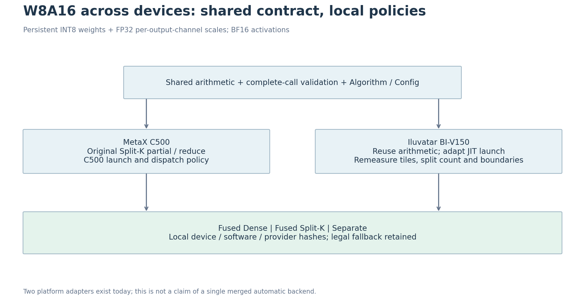
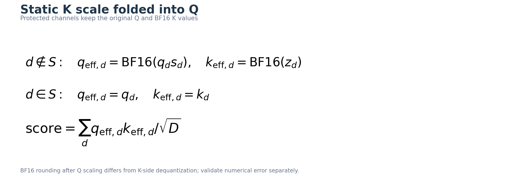
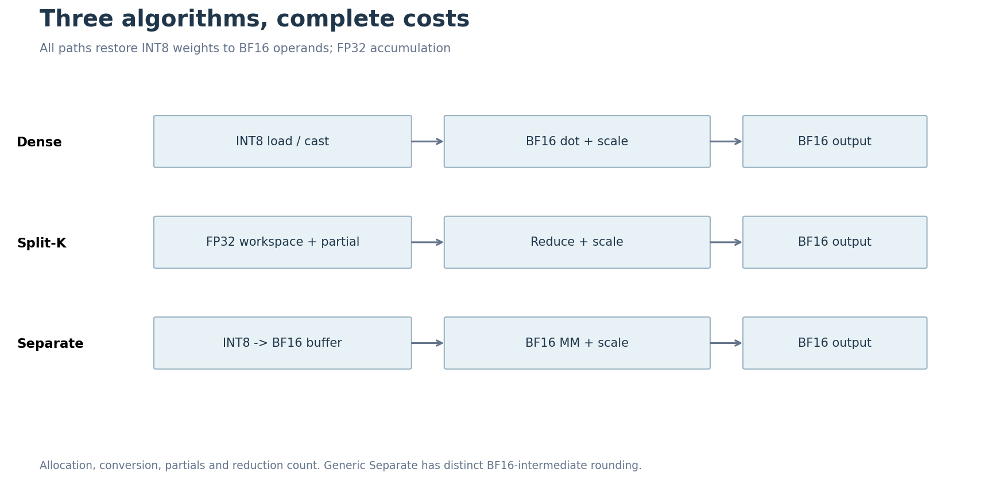
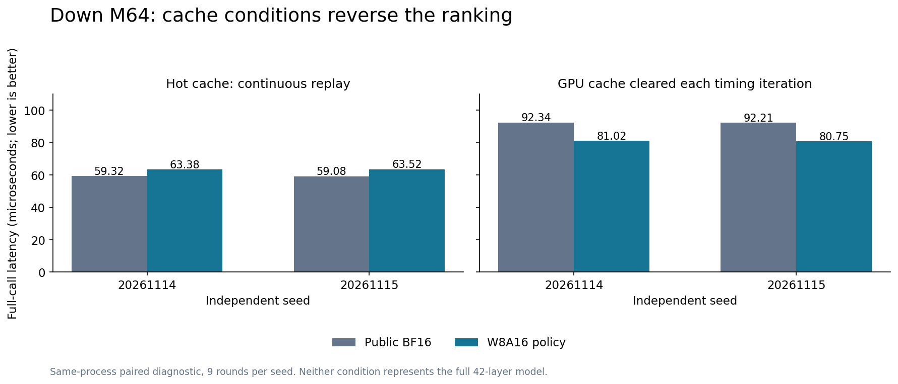
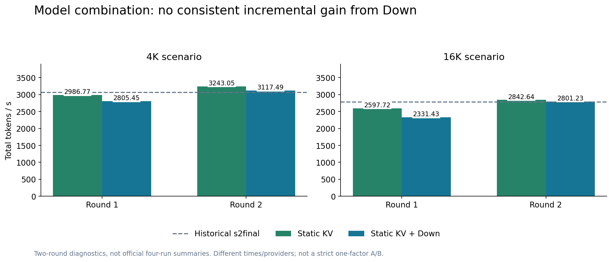

# MiniCPM5-2B跨平台W8A16权重量化与GEMM执行方案

> 量化专项报告｜MetaX C500与Iluvatar BI-V150｜2026-11-16
> 天数模型基线：s2-track2-final，f82fa1670509f081aa13b58464cb6e5627fc10c4。
> 天数实现：feat/tianshu-w8a16-final；沐曦实现：muxifinal。统一的是数值契约、算法框架和验证方式，当前仍为两个设备适配实现，不宣称已经合并为同一个自动跨设备后端。

## 摘要

本方案以静态、对称、逐输出通道INT8权重和FP32 scale为统一表示，输入与输出保持BF16。INT8权重在计算时转BF16，dot以FP32累加，随后乘scale并输出BF16；不依赖原生INT8×INT8矩阵乘。统一研究Fused Dense、Fused Split-K和Separate完整调用，在不同设备上独立选择Algorithm＋Config，并通过权重加载开关、离线策略、提供者及Kernel指纹控制运行路径。

沐曦方案为天数提供已验证的Split-K算术和候选规划思路。天数保留partial与reduce/scale函数体，适配JIT启动，再重新测量分块、K分片与归约配置。Down M64独立图重放完整调用从92.826921μs降为80.790386μs，降低12.966643%，10/10配对轮次更快；同场M64的QKV与O也有较小正收益。最新同进程复核发现，该历史正收益对应do_bench逐次清GPU缓存；热缓存连续重放时，当前BF16约59μs、量化约63～64μs，方向反转。因此12.97%不能作为热缓存或真实42层执行的加速承诺。大M仍需临时BF16转换，Down完整Separate比同场BF16慢约5%～10%，小M收益不能外推为模型加速。

天数在s2final底座叠加静态KV之后加入Down量化，修正provider匹配后完成两轮诊断。相对静态KV同序号第二轮，4K/16K吞吐下降3.87%/1.46%。这是跨时间、不同provider的组合观察，不是量化单因素严格A/B；但没有支持继续部署该组合的端到端收益证据，因此后续没有扩大组合。四投影开关默认关闭，保留代码、配置和完整命令供后续明确授权后继续研究。



*图1：共享的是量化表示、算术和验证方法；启动配置、提供者身份及算法边界在两平台独立验证，当前不是一个已合并的自动跨设备后端。*

## 1. 模型基线、目标与贡献范围

天数模型比较采用s2final，已有#002调度、#003同步消除、#006配置推导、#007设备感知、#009分块放宽及#010 decode warp优化。本次不以初始未优化模型作为增量分母，不纳入perf/BI-V150后续#011～#015；该分支只作为报告写法参考。

microbench采用同场BF16控制，与模型s2final历史基线分开。两者不能混用：前者回答某个Shape的完整量化调用是否更快，后者回答模型叠加是否改善total tokens/s。量化权重节省容量也不能代替吞吐收益。

| 投影 | 本地N/K | 天数开关 |
|---|---|---|
| Down | 2048/6144 | VLLM_FL_TIANSHU_W8A16_DOWN |
| Packed Gate/Up | 12288/2048 | VLLM_FL_TIANSHU_W8A16_GATE_UP |
| Packed QKV | 2560/2048 | VLLM_FL_TIANSHU_W8A16_QKV |
| O | 2048/2048 | VLLM_FL_TIANSHU_W8A16_O |

四项均默认0。LM Head、Embedding保持既有BF16。M为实际GEMM行数，不等于请求并发或图捕获尺寸列表。天数当前模型组合只测Down，没有将四个开关存在写成四投影模型已验收。

## 2. 跨平台统一的数值契约

对本地权重W[N,K]按输出通道n计算FP32 scale，非零通道通常为max(abs(W[n,:]))/127，量化函数处理零通道与数值下限。Q为INT8[N,K]，s为FP32[N]，运行式为：

```text
Q[n,k] = round_and_clip(W[n,k] / s[n])
Y = BF16(FP32_accumulate(BF16(X) × BF16(Q)^T) × s)
```

具体零值处理及舍入细节以各适配实现与参考函数为准，不因统一数学表达声称所有极值输入逐位一致。bias和TP通信保留框架外层顺序，合成分片检查不代替真实TP模型验证。

| 算法 | 完整调用必须包含 | 主要代价 |
|---|---|---|
| Fused Dense | INT8加载/转BF16、dot、scale与输出 | 小M时并行度可能不足 |
| Fused Split-K | FP32 workspace、partial、归约/scale、输出 | 多次launch、partial流量与归约 |
| Separate | INT8→临时BF16转换、实际BF16 MM、scale | 临时权重流量及转换成本 |

融合scale路径在FP32累加后缩放；公开MM的通用回退可能先产生BF16中间输出，再scale。两者舍入契约分别建立参考，不为了通过测试放宽阈值。Kernel误差相对量化矩阵参考、权重量化误差相对原始W、模型准确率是三个不同层次。





*图2：Split-K的workspace/归约、Separate的BF16临时权重转换均属于完整调用。通用Separate的BF16中间舍入与融合scale路径分别验证。*

## 3. 从沐曦实现复用到天数适配

### 3.1 复用算术，重新验证启动与配置

天数Down M64研究从沐曦weight_int8pack_mm.py抽取Split-K partial、串行reduce/scale及向量归约，源SHA256为826ee3b73b01f4cc329286f9e268c87a87f7b069464afe7b121e682f1a9abf03。复用函数体与源AST匹配；移除不适用的pipeline="basic"，外围使用直接triton.jit启动，不导入MetaX后端，不将C500配置阈值照搬至BI-V150。

Split-K有限候选池1215项，243项K整除失败，972项实际尝试；BF16对照590项。总初筛1562项，1406成功、156共享内存超限。再比较归约变体与两seed、五轮eager/graph确认，保留失败/剪枝原因和全部历史记录，不称全局最优。[E1]

### 3.2 复用分发思想，不固守同一个M阈值

天数将精确M点和局部范围、N/K、设备、软件与provider绑定到离线manifest。Down小M使用splitk_muxi，大M使用separate_hotspot；其他投影保留各自融合和Separate路径。探索观察到Down256～264、Gate/Up192～200、QKV/O128～136附近交界，仅为所测配置下的区间，不是算法合法性阈值。[E2]

不同算法之间未采样的间隙保守选择Separate；未知shape或版本失效走separate_generic。该回退仍以INT8权重真实转换BF16，没有原始BF16副本，不应称“回到原始精度”。推理和capture期间不做大规模搜索。

### 3.3 大M继续计入转换，复用BF16提供者

Separate允许试验NK或KN临时BF16布局；INT8持久表示没有加载时KN预打包或常驻BF16副本。GROUP_M、store mask与转换参数须按完整调用联调，而不是只拿纯BF16 MM的最快tile。

天数大M联合研究显式保留同实现的优化BF16控制。Gate/Up相对原版BF16虽更快，但比同优化BF16仍慢5.75%～11.46%，表明其中很多改善属于可被纯BF16复用的MM配置优化，不是量化独有收益。底层BF16 MM沿用提供者，本文不将其整体实现归为量化原创。[E3]

## 4. microbenchmark：正收益与边界同时呈现

### 4.1 Down M64的跨平台复用结果

| 模式 | BF16 μs | Split-K μs | 耗时降低 | 配对胜出 |
|---|---:|---:|---:|---:|
| eager | 90.544231 | 77.813461 | 14.060277% | 10/10 |
| graph | 92.826921 | 80.790386 | 12.966643% | 10/10 |

量化配置BM64/BN64/BK64/warps8/stages1/S4，向量reduce block256/warps4；workspace为2MiB，实际分配与归约均计入完整调用。Kernel relative L2≤0.005、normalized max≤0.01、输出有限；这些门槛不代表权重量化误差或模型精度。历史输入/权重虽然重复，实际do_bench仍逐次清GPU缓存，因此不能称为热缓存收益，也不能代表42层真实工作集。[E1,E5]

### 4.1.1 最新复核：缓存条件使胜负反转

最新两seed各9轮同进程随机顺序复验，当前公开BF16与policy完整调用的各seed中位数如下；没有重新调配置，数据来自已归档隔离实验，不是本次报告新增GPU测试。[E5]

| seed | 条件 | BF16 μs | W8A16 μs | 量化延迟变化 |
|---|---|---:|---:|---:|
| 20261114 | 热缓存连续重放 | 59.323 | 63.377 | +6.83% |
| 20261115 | 热缓存连续重放 | 59.077 | 63.523 | +7.53% |
| 20261114 | 每次计时前清GPU缓存 | 92.338 | 81.021 | −12.26% |
| 20261115 | 每次计时前清GPU缓存 | 92.212 | 80.754 | −12.43% |



*图3：同seed、同provider、同一进程，不同缓存计时条件使方向反转。历史固定入口与当前入口在相同条件下接近，支持缓存口径是历史差异的主要解释；没有硬件命中率计数，不声称已证明所有模型阶段的成因。两种micro都不自动代表42层工作集；官方测评不能插入清缓存步骤。*

### 4.2 四投影同场M64复验

| 投影 | BF16 graph μs | 量化graph μs | 耗时变化 |
|---|---:|---:|---:|
| Down | 92.939425 | 80.892310 | −12.9623% |
| Gate/Up | 126.253847 | 134.840384 | +6.8010% |
| QKV | 50.197115 | 45.539423 | −9.2788% |
| O | 42.278847 | 40.237500 | −4.8283% |

Down/QKV/O均10/10更快，Gate/Up10/10更慢。Down M1还观察到21.7814%耗时降低，但交界和留出点存在明显退化；52个调优点中仅11点更快，采样偏重交界，不可将点数占比作为模型耗时权重。[E2]

### 4.3 大M实际runtime op graph复验

| 投影 | M | BF16 μs | 完整量化runtime μs | 延迟变化 |
|---|---:|---:|---:|---:|
| Down | 2048 | 571.458 | 629.508 | +10.16% |
| Down | 4096 | 1119.108 | 1175.806 | +5.07% |
| Gate/Up | 2048 | 1428.687 | 1307.827 | −8.46% |
| Gate/Up | 4096 | 2840.440 | 2482.519 | −12.60% |
| QKV | 2048 | 297.567 | 307.583 | +3.37% |
| QKV | 4096 | 510.319 | 523.050 | +2.49% |
| O | 2048 | 215.538 | 229.588 | +6.52% |
| O | 4096 | 404.050 | 421.296 | +4.27% |

该表含实际opaque-op包装，每点5次配对；与独立Kernel绝对耗时不混为同一口径。Gate/Up更快也不能忽略前述同优化BF16控制。micro不足1%的变化依重复与配对稳定性解释，不套官方±1%门槛。[E3]

## 5. 相对s2final的模型观察与Down组合负结果

模型基线固定为s2final/f82fa16，其历史官方结果为4K3073.11、16K2790.28 tok/s。静态KV单独和静态KV＋Down均为之后各两轮诊断；相对s2final是组合整体的历史增量，不是W8A16单项收益。

| 场景 | 轮次 | s2final tok/s | KV＋Down tok/s | 相对s2final | 相对同轮KV单独 |
|---|---|---:|---:|---:|---:|
| 4K | 1 | 3073.11 | 2805.45 | −8.71% | −6.07% |
| 4K | 2 | 3073.11 | 3117.49 | +1.44% | −3.87% |
| 16K | 1 | 2790.28 | 2331.43 | −16.44% | −10.25% |
| 16K | 2 | 2790.28 | 2801.23 | +0.39% | −1.46% |

全部请求成功，但两轮不替代官方四轮summary，不能只选第二轮。静态KV与组合provider不同，未同场重测s2final，不将负变化全部归因为Down；也不能用历史KV精度101/105证明组合精度。

首次组合因遗漏原gems路径走separate_generic，保留为接入失败，不能当专用Split-K负结果。修正后9点policy匹配、42层Down启用、35图确认才获得上表。完整TTFT、原始CSV、开关和provider差异见[E4]。目前没有稳定的模型正收益支持继续扩大Down组合，因此后续未推进Down＋QKV/O，没有继续运行精度或官方完整性能；开关和策略保留，后续需明确授权再调优。



*图4：保留两轮原始吞吐，不择优。虚线为历史s2final，而非同场重测基线；绿色与蓝色提供者/时间存在差异，不能从柱差直接推导Down单因素因果收益，更不是完整官方summary。*

## 6. 统一框架下的跨设备差异

| 维度 | MetaX C500 | Iluvatar BI-V150 |
|---|---|---|
| 权重/scale/激活 | INT8/FP32/BF16 | 相同数值格式 |
| Split-K算术 | 沐曦源partial＋reduce/scale | 复用函数体，JIT启动适配 |
| Algorithm＋Config | C500离线策略 | 天数独立测量与边界 |
| Separate | C500 BF16提供者与scale融合 | 天数固定provider、NK/KN转换与热点配置 |
| 模型组合 | muxifinal的Down-only及配套优化 | 当前Down叠加没有可归因端到端正收益 |
| 模型精度/成绩 | 见沐曦已归档报告 | 不能继承沐曦或KV单独成绩 |

统一方案应共享表示、算法接口、完整计时、误差参考与manifest字段；设备能力、编译资源、布局、配置、提供者及算法边界仍须分别验证。当前实现是这一统一设计的两个适配，不宣称已完成公共代码抽取或统一manifest schema。对新设备可复用方法与函数，不能复用实测结论。

## 7. 开关、复现与后续调优

四个天数开关均默认0，加载时读取，改动必须重启。Down单开为DOWN=1、GATE_UP/QKV/O=0；继续探索其他投影时独立设置并核对实际覆盖，不在图内热切换。完整环境、9点策略检查、M64搜索、服务、官方性能和精度命令见 [004](004-开关与完整复现命令.md)。该独立分支不含静态KV实现，组合需原隔离源码及可追溯ABI，不是多设一个K_STATIC_FOLD就能复现。

后续顺序应为：核对同provider BF16控制→真实M与调用/耗时覆盖→定位大M转换及图内buffer成本→有限局部调优→确定量化组合→组合精度→同版本官方双场景A/B。当前未实施这些新增研究，不写成已有成果。缺少新收益时保留负结果并停止，不以容量节省替代性能。

| 证据 | 内容 |
|---|---|
| [E1：001](001-复用沐曦分片归约与天数小批量优化.md) | 源码复用、候选、M64配对正收益 |
| [E2：002](002-算法分界与四投影独立开关.md) | 四投影、分界、留出、失败与通用回退 |
| [E3：003](003-大批量转换融合与运行时接入.md) | 大M实际runtime结果、数值与版本绑定 |
| [E4：005](005-Down叠加负结果与停止推进.md) | s2final与KV两种分母、负结果、开关、停止状态 |
| [E5：006冷热缓存复核](<006-Down M64冷热缓存计时口径复核.md>) | 两seed冷热配对、do_bench运行时源码与原始记录 |
| `docs/optimization/evidence/2026-11-16-w8a16/` | M64选择、原始模型CSV、策略/覆盖及计算值 |

本次为源码与文档整理，没有新GPU实验。BF16提供者采用原微测mm.py字节，SHA256为fd120991ed1c5cab988d02cbdb1d97ccde1e9e2eedad55affe90321d875f32ed；其他镜像依赖仍需复核。最终是否获得赛事收益取决于同环境正式模型验收，不由本报告中的micro结果决定。

## 图件与复现

五幅图提供PNG/SVG及生成脚本。SVG字体转为路径，公式用Matplotlib数学渲染。冷热图读取已提交results.jsonl，不合并两seed或改写原记录；模型图直接读取静态KV和组合两份原始CSV。架构/算法图为代码流程示意，不暗示硬件计数或新性能成绩。

```bash
cd /workspace/vllm-plugin-FL
MPLCONFIGDIR=/tmp/w8a16-report-mpl python3 report-assets/generate_figures.py
```

CPU侧Matplotlib/NumPy即可生成，勿将制图当成GPU验证。本次未改生产策略或默认开关，也未恢复已停止的组合调优。
