# MiniCPM5-2B 跨平台量化优化技术报告

> 量化专项 · MetaX C500与Iluvatar BI-V150 · 2026年11月16日

## 摘要

本作品从MiniCPM5-2B的实际推理热点出发，研究权重与KV缓存的低位宽存储及配套执行优化。历史分阶段分析表明，GEMM在多个负载中占主要GPU时间；进一步按投影和矩阵形状测量发现，压缩权重后新增的转换、归约及输出缩放会抵消带宽收益，不能通过统一量化所有投影获得稳定加速。长上下文KV量化也面临类似问题：动态异常通道保护、反量化和额外写入调用可能抵消缓存压缩收益。

针对这些问题，权重路线采用逐输出通道W8A16，并联合设计三算法分发、小M分片归约、大M转换与scale融合；缓存路线采用静态K scale、固定异常通道保护、scale折入Q及Q变换与KV写入融合。两条路线均保留BF16乘法与FP32累加，通过完整调用而非局部Kernel计时验证优化。

实验表明，沐曦Down大M联合配置相对原量化专用配置使M2048/M4096完整调用耗时分别降低约20.75%/33.70%；天数小M权重量化的收益受缓存条件影响，不能直接外推到模型。静态KV在部分长上下文形状取得完整调用收益，并以101/105通过模型精度数值门槛。沐曦包含量化及配套优化的最终组合在4K/16K达到5668.66/8675.61 total tokens/s，相对同容器默认BF16提高12.24%/24.27%，精度102/105。下文依次说明问题定位、具体优化、消融和总体效果，并在末章说明其他优化改变热点后的适配。

## 报告目录

1. 问题定位与方案设计思路
2. 算法原理、实现架构与优化策略
3. 实验环境与测试方法
4. 消融实验、测试结果与效果分析
5. 模型总体测试结果与效果分析
6. 与其他优化的协同适配

## 1 问题定位与方案设计思路

### 1.1 从分阶段性能分析定位主要计算开销

我们首先对4K和16K负载分别观察Prefill、Decode与整体执行，共形成六组Kernel分析。通过设备时间线采集计算、API与内存事件，再汇总各类Kernel的累计GPU时间，得到以下历史结果。

| 采样场景 | GEMM占GPU Kernel时间 | Attention占比 | 定位结论 |
|---|---:|---:|---|
| 4K Prefill | 约94% | 约3.6% | 大矩阵乘法是主要优化对象 |
| 4K Decode | 约80% | 约9.5% | 小M矩阵乘法仍占主要时间 |
| 16K Prefill | 约64% | 约29% | GEMM与长上下文Attention均有显著成本 |
| 16K Decode | 约70% | 约21% | 需同时关注权重读取与长KV消费 |
| 整体4K | 59.6% | 约31.8% | 高并发下两类算子共同影响吞吐 |
| 整体16K | 47.6% | 约46.5% | 长上下文使KV相关执行成本更突出 |

这些占比是各采样窗口的GPU时间占比。历史采样仅对Decode采用完整图捕获，分阶段负载与整体负载的并发不同，因此不直接横向计算加速，也不将其作为新环境的官方性能基线。它们用于确定研究对象；天数的收益仍须在天数设备上独立验证。

### 1.2 从GEMM热点进一步定位投影和实际矩阵形状

模型含42层，hidden size为2048，MLP中间维为6144。我们将矩阵乘记作X[M,K]与W[N,K]，记录真实执行的M、N、K和布局。M是一次计算的行数，不等于请求数或固定并发数。

| 投影 | N | K | 性能特点 |
|---|---:|---:|---|
| Down | 2048 | 6144 | K较长，小M时可沿K切分增加并行度 |
| Packed Gate/Up | 12288 | 2048 | 输出维大，不能直接照搬Down配置 |
| Packed QKV | 2560 | 2048 | 额外转换和启动成本占比可能更明显 |
| O | 2048 | 2048 | 需独立验证融合收益与调度成本 |

直接将INT8权重转换为完整BF16暂存再执行矩阵乘，会新增转换、暂存读写及输出缩放。小M还可能因输出网格太小而无法充分利用设备。初步投影对照显示Down有改善，而其他投影可能退化，由此确定“按投影和Shape选择量化”的策略，相关对照数据集中列于消融章节。

### 1.3 低位宽并不自动消除执行瓶颈

| 已定位问题 | 形成原因 | 对应优化方向 |
|---|---|---|
| 小M量化GEMM并行度不足 | 输出tile少，单纯减少权重字节不足以提高利用率 | 沿K切分，联合选择分片数与归约配置 |
| 大M转换和独立scale开销 | 生成BF16暂存，输出额外读写与启动 | 优化转换粒度，融合scale，再调MM分块 |
| 配置搜索记录与执行可能不一致 | 启动缓存可能复用不同配置的编译产物 | 显式传递启动参数并核对实际编译信息 |
| 动态K保护与恢复开销 | 每步选择通道、保存位置、读取时恢复 | 固定保护通道，静态scale折入Q |
| 折Q新增调用成本 | 单独变换Q、写入KV再执行Attention | 联合Q/K/V入口，融合Q变换与写入 |
| 历史micro收益无法解释当前模型 | 缓存条件、BF16提供者和实际Shape变化 | 同条件复验，检查真实入口和模型组合 |

### 1.4 KV量化需要同时控制误差和读取成本

MiniCPM5-2B具有16个Q heads、2个KV heads，每head维度128。长上下文生成需要反复读取历史K/V。仅量化V可以减少PV阶段读取量，但K仍占用BF16存储；进一步量化K时，异常通道会影响QK得分。动态保护四个通道的误差较小，却需要选择与恢复操作。我们的后续设计因此同时处理“保护哪些通道”和“scale在哪里乘”，再处理新计算链增加的调用成本。

## 2 算法原理、实现架构与优化策略

本章先介绍权重路线的数值契约和执行组织，再介绍KV路线的校准、存储及联合执行；第4章对各设计进行对照验证。

### 2.1 总体技术路线与实现架构

整体流程为：实际Shape与布局定位 → 量化数值契约 → 完整执行链 → 算法和配置联合搜索 → 模型接入 → 消融、精度与双场景性能验证。

| 架构层次 | W8A16权重量化 | 静态KV INT8 |
|---|---|---|
| 参数生成 | 加载时按输出通道量化 | 独立文本校准K，V逐token/head动态量化 |
| 存储表示 | INT8权重与FP32 scale | INT8 K/V、BF16保护值及FP32 V scale |
| 执行层 | Dense、Split-K、Separate | Q变换与写入、Attention、分段归约 |
| 策略层 | 按M/N/K、布局和设备选算法与分块 | 按batch/Q长度选择写入与分段配置 |
| 模型接入 | 权重加载、运行时分发、合法回退 | 联合Q/K/V接口、页分配和共享工作区 |
| 一致性保障 | 设备与提供者版本校验、实际编译配置核对 | 校准参数与缓存格式绑定、图接口隔离 |

权重和KV分别解决不同数据流的成本。它们可以独立研究，但组合后的精度与性能需要重新评测。跨平台统一的是数值表示、算法思想和验证方法，设备配置与性能分界独立选择。

### 2.2 W8A16数值原理与存储表示

对原始 BF16 权重先转 FP32，按输出通道 n 计算：

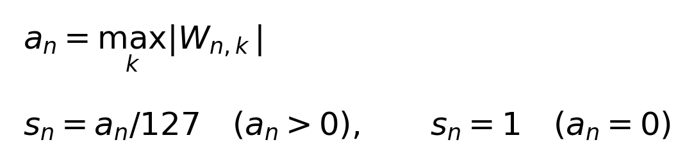

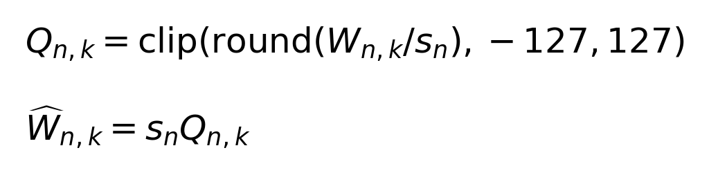

Q 为连续 INT8 `[N,K]`，s 为连续 FP32 `[N]`；全零通道使用 scale=1 避免除零。量化在本地权重分片加载完成后进行，不依赖评测集校准，不修改激活格式，也不改变上层 RowParallelLinear 的通信与 bias 处理。

INT8 整数范围可由 BF16 精确表示。因此所采用的 scale-after-dot 计算为：

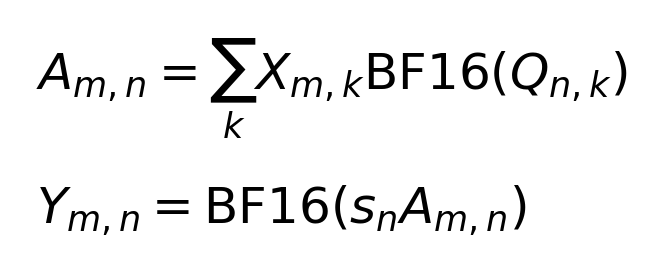

其中乘法输入为 BF16、累加为 FP32。将每输出通道固定的 scale 提出 K 维求和，避免每个权重元素在 dot 前重复乘 scale。这不是原生 INT8×INT8 GEMM，且有限精度实现不应与逐元素先反量化再 BF16 GEMM 宣称逐位等价。

忽略分配对齐，原始单层权重为 `2NK` 字节，量化后持久权重和 scale 为 `NK+4N` 字节。Down 的 N=2048、K=6144，因此：

| 项目 | 单层持久存储 |
|---|---:|
| BF16 权重 | 24 MiB |
| INT8 权重 | 12 MiB |
| FP32 scale | 8 KiB |
| 理论净减少 | 约 11.992 MiB |

42 层 Down 的理论持久权重净减少约 503.67 MiB。这是按 Shape 推导的存储量，不是实测峰值显存。大 M Separate 路径仍需 BF16 权重暂存，小 M Split-K 需要 FP32 workspace；实际峰值还受到分配器、图捕获等因素影响。实现不持久保留原始 BF16 权重副本。

### 2.3 三算法协同处理不同M范围

| 算法 | 数据流 | 主要优势 | 主要代价 |
|---|---|---|---|
| Fused Dense | INT8 tile加载→BF16转换→dot→scale→输出 | 不生成完整 BF16 权重暂存 | 小 M 时 CTA 数可能不足；转换与 dot 调度受资源影响 |
| Fused Split-K | 沿 K 分片→partial FP32输出→reduce/scale→BF16输出 | 增加小 M 并行度 | workspace、额外归约和启动成本 |
| Separate | 完整 INT8转BF16→BF16 MM→scale | 复用成熟 BF16 MM 提供者 | 转换与暂存成本，原路径还有独立 scale |

最终 Down 热点主要选择小 M Split-K、大 M Separate。Dense 能力与合法回退保留；不能将“当前没有选择”理解为删除算法。

Split-K 将 K 维划分为 S 个分片：

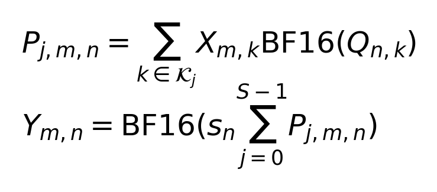

M64、BM64、BN64、N2048、S8 时，partial 网格为 `1×32×8=256` 个 CTA；不切 K 时相应二维网格仅 32 个 CTA。增加 S 能改善并行度，但会增加归约及工作区成本，所以不能仅按 partial 单核时间选 Split 数。

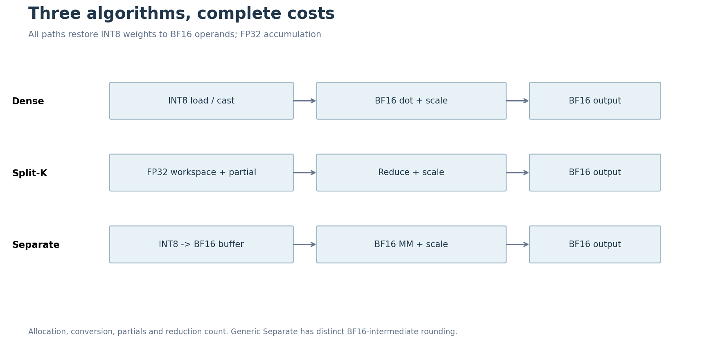

*图1　三种算法均按完整执行链计时；转换、工作区和归约均属于实际成本。*

### 2.4 小M优化：用K分片增加并行度

沐曦M56/M64采用BM64、BN64、BK128、4 warps、1 stage、8个K分片。每个分片将INT8权重转换为BF16并计算FP32部分和，最后统一归约和缩放。分片越多，输出并行度越大，但工作区、归约及启动成本也会增长，因此配置选择以完整调用为准。

我们进一步比较了分片数、共享内存布局、预取、流水线和权重物理布局。最终保留跨seed、实际入口与图重放中稳定的配置；没有把单次初筛领先的候选直接接入模型。具体淘汰结果见消融章节。

### 2.5 大M优化：转换、scale融合与分块联合设计

第一步，将每次INT8到BF16转换的处理粒度从1024扩大到4096，保持4 warps，减少转换链路的完整调用成本。BF16暂存仍在每次真实调用中产生，没有把转换移到计时之外。

第二步，将独立scale阶段移入矩阵乘的输出阶段。原路径先写出BF16中间结果，再读取、缩放、写回；融合后直接对FP32累加值乘每输出通道scale，再写出BF16，从而减少独立调用与输出往返。

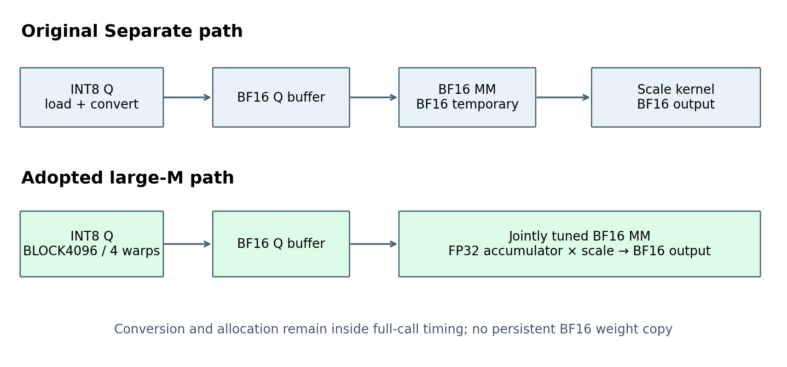

*图2　融合消除独立输出缩放阶段，保留实际权重转换。*

融合改变了舍入位置。我们单独定义原中间BF16舍入和直接FP32缩放的参考，并以模拟旧舍入的融合对照区分数值与执行影响。

第三步，在固定新转换和融合路径上重新选择MM分块。沐曦M193～384采用64/128/128，M385～16384采用128/128/128，均为4 warps、4 stages及异步复制流水线。范围策略由代表点、交界和留出点复验支持；更大tile并不天然更优，资源超限或完整调用退化的候选被淘汰。

### 2.6 搜索与运行时分发

先按dtype、布局、尾块、K分片和设备资源检查能力，再比较算法与配置。候选按真实N/K分组共享，保留原配置作为控制项；代表M初筛后，对交界和异常点追加局部搜索，并以独立seed、实际入口和图重放复核。有限搜索只说明所测范围内较优。

小M与大M的算法分界、同算法内部的tile分界分别管理。沐曦当前主要选择小M Split-K、大M Separate，同时保留Dense与合法回退。运行时使用已固化策略，版本或布局不匹配时采用合法通用路径；请求和图捕获阶段不进行大规模搜索。

针对启动缓存可能混淆配置的问题，显式传递线程束数、流水深度等参数，并核对实际编译信息。这样，记录的候选才与真实执行配置对应，缓存命中也不会被统计成新增测量。

### 2.7 天数适配：复用算术，重新验证设备配置

天数复用沐曦Split-K的部分和及归约/scale算术，调整编译启动方式，独立搜索tile、K分片和归约配置。初筛共尝试1562个配置，其中1406成功、156因共享内存限制失败，之后进行多seed与图重放复验。

天数的算法交界和大M转换布局按设备重新测量，不照搬沐曦阈值。对于Gate/Up，大M量化相对原版BF16虽更快，但相对同样优化后的BF16仍慢5.75%～11.46%，说明部分改善可由纯BF16配置优化获得。最终选择必须与同等优化程度的BF16对照比较。

#### 权重量化分发边界与回退

沐曦的被测策略中，Down在M1～112主要使用Split-K，M≥113进入Separate；M193与M385分别是Separate内部配置分界。它们是特定设备和版本上的性能策略，不是算法合法性的数学边界。范围外或版本不匹配时使用合法通用路径，已量化权重的回退仍需转换，不能假定存在原始BF16权重副本。配置区间中的代表点、边界和留出点已验证，未逐一穷举所有M。

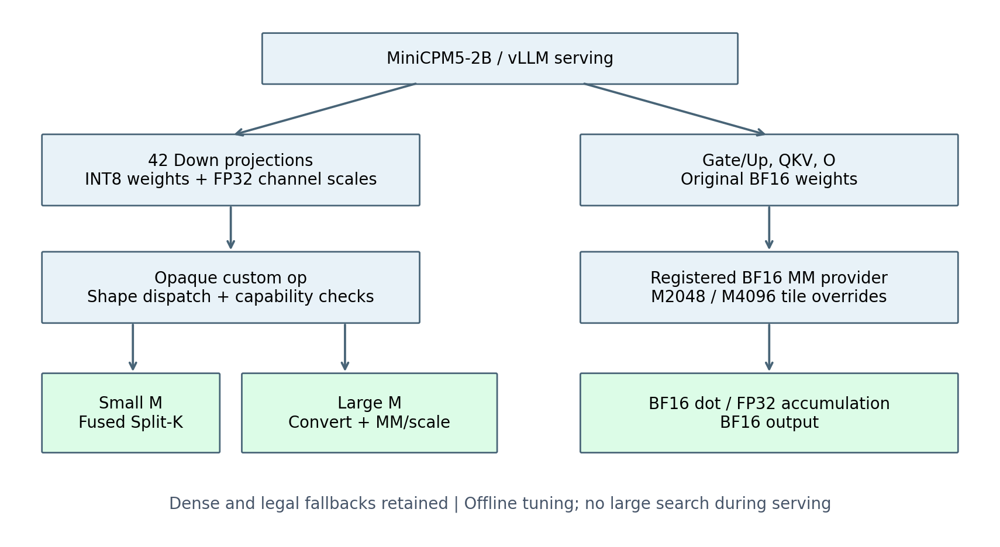

*权重量化的加载、运行分发与BF16计算路径。图中Down为最终量化投影，其他投影保持BF16。*

#### 两平台为何采用不同的量化范围

沐曦平台的 Attention 算子采用固化实现，且不属于 FlagGems，无法通过本次算子源码优化直接修改 KV 的读取与计算逻辑。因此，本方案在沐曦平台重点优化 GEMM 权重量化，KV 保持原有路径。KV 量化方案在天数平台独立实现与验证；其在沐曦平台的适配和效果尚未验证。

### 2.8 KV量化方案：固定保护与静态K scale折入Q

KV量化是本作品的第二条完整技术路线，主要面向天数BI-V150的长上下文缓存。其目标是在控制QK得分和Attention输出误差的同时降低历史KV的存储与读取成本。V按每个token、每个KV head动态计算对称INT8 scale；K按层、KV head和通道使用离线确定的静态scale，每个KV head另保留四个BF16保护通道。Attention消费时将INT8数据恢复为BF16操作数并进行计算，FP32用于累加。该设计不需要原生INT8×INT8 Attention。

方案由独立校准、KV量化写入、Q变换、历史KV读取、Attention计算及分段归约组成。量化写入和Q处理都计入完整调用，最终通过独立数值测试、模型精度和性能测试验证。两条量化路线服务于不同的数据流，其模型精度和性能不能互相代用。

固定每个KV head的四个保护通道，将其原始值保留为BF16，其余K通道使用静态逐通道scale量化。Q/K在RoPE后采用相同排列，把保护通道放在固定位置，减少动态位置描述和恢复成本。

记固定保护集合为 S，K 的通道 scale 为 s[d]。对未保护通道，缓存保存 `z[d]=INT8_round_clip(k[d]/s[d])`；保护通道另存原始 BF16 k。Q/K 在 RoPE 后使用相同排列 P，先放四个保护通道，再放其余通道。

在排列后的空间中：

```text
保护通道：q_eff[d] = q[P[d]]，k_eff[d] = 原始 BF16 k[P[d]]
其余通道：q_eff[d] = BF16(q[P[d]] × s[P[d]])
          k_eff[d] = BF16(z[P[d]])
score = FP32_accumulate(q_eff · k_eff) / sqrt(D)
```

保护通道的 Q 不乘 scale，否则恢复的原始 K 会与被缩放 Q 相乘，破坏点积。相同通道置换本身保持点积结构，但量化与 Q 端 BF16 舍入引入误差；折Q与在 K 端反量化的舍入位置不同，不能声称逐位等价。

静态 scale 与历史 KV 长度无关，因此可以一次变换本步 Q，在所有历史 token 的 QK 计算中复用，避免在每个 K tile 上重复乘 per-channel scale。INT8 K 仍在 dot 前转 BF16，保护值覆盖对应位置；softmax 和 PV 继续遵守所绑定 Attention 提供者的计算路径。

V 沿用动态 per-token/head scale：`s_v=max(max_abs(v)/127,1e-6)`，写入 INT8，读取时恢复为 BF16 后参与 PV。GPU writer 对 K/V 使用其已固化的带符号半单位偏移、截断及 `[-128,127]` 裁剪；不将 CPU 原型的抽象 round 视为所有边界逐位相同的实现。

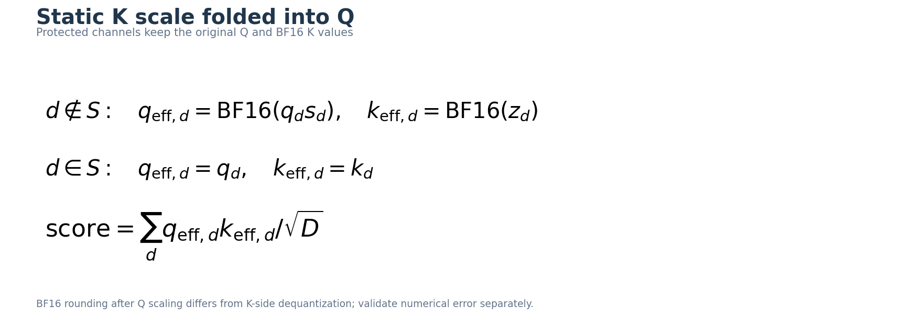

*保护通道不缩放Q；未保护通道在Q端乘静态scale并舍入BF16。*

### 2.9 KV量化参数校准与缓存格式

生产校准使用 8 段独立自写中文、英文、代码及符号说明文本，不使用 math_500。每例取 512/4096 token，另英文 16384，BF16 轨迹 Decode 8 步；Decode 只统计新增 token。每层累计 53384 个 token，按动态 top4 频率确定固定四通道，并列按小索引；其他通道 scale 为通道最大绝对值/127，先设下限再乘 margin2。

参数包含42层各两个KV head的排列、FP32 scale和保护位置，并与模型版本绑定。另用四段新留出文本完成 756 条层级 Prefill/Decode 检查，756/756 通过，最坏 max abs=0.17198110、NRMSE=0.04596736。参考为 BF16 操作数与 FP32 完整 softmax，不是 GPU online-softmax 的逐位模拟；BF16 轨迹筛查也不覆盖长程量化反馈，仍需真实模型精度。

沿用 page32、token-major、separate_meta：K/V 主体与元数据分开寻址，保护值保存在 K 的元数据区域，V scale 为 FP32。保护通道前置后，读端恢复固定位置，不做每 token 动态 top4 索引匹配。

| 每 token、每 KV head | 分配字节 |
|---|---:|
| K INT8 主体，D=128 | 128 |
| K 元数据区域，含四个 BF16 保护值及保留/对齐空间 | 16 |
| V INT8 主体 | 128 |
| V FP32 scale | 4 |
| 合计 | 276 |
| 原 BF16 K＋V | 512 |

减少比例为 `1−276/512=46.09375%`，仅对应缓存格式。同等纯 KV 字节预算下理论 token 槽位比为 `512/276≈1.855`；模型还占用权重、图、Q/归约工作区及分配器空间，不能把该比例当作实测容量或吞吐比。真实精度服务记录 KV 容量 971168 tokens，没有同环境容量 A/B，不归因其差值。

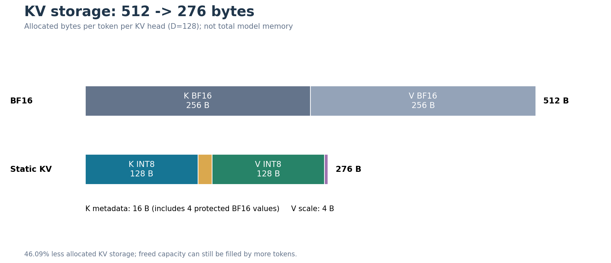

*图3：276字节包含保护元数据和V scale。46.09%是每token/head格式节省，非模型总显存或吞吐收益；空出的容量仍可能被新增token吃满。*

### 2.10 KV量化执行优化：融合Q变换、写入与分段

静态方案的第一版执行为“独立 Q 变换→KV writer→Attention→归约”。长 KV 能摊薄前两项成本，短 KV 和小 Prefill 则容易被新增 launch 和 Q 读写拖慢。因此后续优化接着处理调用成本，而非继续只减少缓存字节。

比较了三种融合位置：

| 候选 | 执行方式 | 主要取舍 |
|---|---|---|
| Attention 内处理Q | 每段读取Q时置换并缩放 | 省独立调用，但各段重复处理Q |
| 按 KV head 融合 writer | 每 token/KV head 同时处理其8个Q heads并写KV | 省launch，但只有2个KV head的并行度 |
| 按 Q head 融合 writer | 每 token/Q head处理Q，每组第一个head额外写KV | 16个Q heads并行，每个KV槽位只有一个writer |

最终采用按Q head并行的融合写入方式。先处理 Q，再判断负 slot，保证图 padding 中不写 KV 的 token 仍得到正确 Q 变换；实际写入遵守物理 slot_mapping，不假设逻辑 token 连续对应物理缓存。

融合仍写出变换后的 BF16 Q 工作区，不能描述成彻底消除 Q 中间存储。收益来自减少独立调用和调整并行划分；它还要接受完整调用验证。

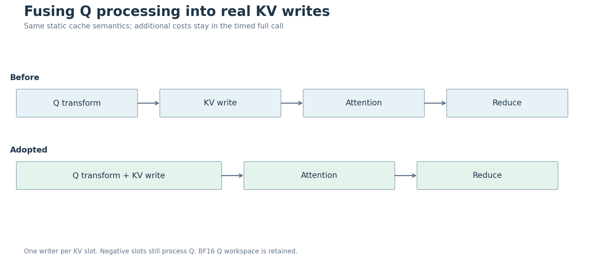

*图4：减少独立Q处理调用，但仍保留BF16 Q工作区及必要归约。前后各阶段不按独立中位数相加，性能以完整调用比较。*

Q融合改变了固定开销，旧动态 K 的参数不保证适合静态方案。离线比较 tile、warps、segments 和 writer 配置，按 batch/Q长度及分支固化；运行时不依据每步 KV 长度挑各自最快配置，也不在图捕获/请求中大规模搜索。

72/80 batch 的候选扩大内部3D分段范围并预分配相应 workspace，以同一8段配置覆盖所测短/长 KV。该改动与 Q融合共同组成被测策略，不能把全部收益归因于“少一次Q Kernel”。未知 batch/Prefill 使用同一静态格式的 canonical 合法路径，不切换成另一种缓存解释。

### 2.11 模型接入与图生命周期

权重侧在加载完成后量化选中投影，运行入口保留动态M分发。沐曦最终量化42层Down，其他投影、Embedding和LM Head保持BF16；量化后若走反量化回退，恢复的是量化矩阵的BF16表示，不能恢复原始权重精度。

KV侧采用能同时接收Q/K/V的联合接口，将真实写入与Attention放在同一执行链；图捕获前预分配Q及FP32归约工作区，42层按执行顺序复用。写入遵守物理slot映射，padding token即使不写KV也完成正确的Q变换。缓存格式与图接口绑定，避免复用旧接口的编译图。不同缓存语义通过新服务进程隔离。

### 2.12 技术创新点

本方案的主要贡献集中在三方面：一是低位宽表示与实际消费链协同设计，将scale后移至GEMM输出端、将静态K scale前移至Q端；二是围绕量化新增成本进行融合与联合配置，分别处理小M并行、大M转换和KV写入；三是将真实Shape、编译配置和模型执行条件纳入验证，避免用容量收益或单点micro代替模型收益。原生BF16 MM底层复用已有实现，其他团队优化的贡献单独说明。

## 3 实验环境与测试方法

| 项目 | 沐曦 | 天数 |
|---|---|---|
| GPU | MetaX C500，64 GiB | Iluvatar BI-V150 |
| 模型与并行 | MiniCPM5-2B，单设备 | MiniCPM5-2B，TP1 |
| 激活与输出 | BF16 | BF16 |
| PyTorch | 2.8.0+metax3.7.0.7 | 2.10.0 |
| Triton | 3.0.0+metax3.7.0.7 | 3.6.0 |
| vLLM | 0.24.0+empty | 0.24.0 |
| 驱动与运行时 | 驱动3.8.30，MACA3.7.0.38 | 采用对应实验环境，驱动版本本稿不补写未知值 |

天数表列软件为静态KV实验参考；各项W8A16对照绑定其对应BF16提供者。不同设备和不同提供者的结果分别比较。

验证分三层。第一层检查Kernel相对量化参考的误差、量化相对原始数据的误差及算法舍入差异；第二层测包含转换、工作区、归约和输出的完整调用，分别记录普通执行与图重放；第三层执行模型精度和官方性能评测。编译与搜索耗时不混入稳态计时，GPU独立测试与模型测试串行，切换模式时重启服务。

| 官方场景 | 输入长度 | 输出长度 | 并发 | 每轮请求数 |
|---|---:|---:|---:|---:|
| 4K | 4096 | 1024 | 64 | 256 |
| 16K | 16384 | 1024 | 64 | 128 |

每场景4轮，跳过首轮，后三轮取平均；保留内部warmup，不在两个场景之间额外清缓存。吞吐提升率为候选/基线−1，TTFT降低率为1−候选/基线；严格超过1%为有效改善，±1%含边界为正常波动。性能指标为total tokens/s，TTFT需无有效退化。算子micro根据重复、配对及离散程度解释，不套用官方1%阈值。

模型精度使用math_500 Level 3，105题，最低准确率0.950；保持temperature=1.0、top_p=0.95、max_tokens=32768与评测batch=8。校准使用独立文本，单次随机生成精度变化不作为能力提升证据。

## 4 消融实验、测试结果与效果分析

### 4.1 投影选择：为什么保留Down量化

历史同场 M64 完整调用比较如下，单位 μs。量化 dispatch 使用各投影实际选中的算法，包含相应附加成本。

| 投影 | 原始 BF16 | 量化 dispatch | 独立转换 Separate |
|---|---:|---:|---:|
| Down | 72.56 | **62.22** | 120.78 |
| Gate/Up | **65.45** | 89.82 | 155.73 |
| QKV | **35.52** | 41.12 | 60.39 |
| O | **34.70** | 37.71 | 55.47 |

Down 的该次量化完整调用比 BF16 低约 14.25%；其他三个投影在此实验中没有取得收益。随后保留四投影量化做模型级验证，历史官方结果的 4K/16K 吞吐相对当时对应基线下降 16.88%/29.62%。这促使最终组合收敛为 Down-only，而不是继续以量化层数或节省容量作为目标。

上述负结果属于当时的实现与配置，不能推出其他投影永远不适合量化；同样，不能把早期四投影量化的收益或损失作为最终 Down-only 的实测成绩。

### 4.2 转换粒度：固定其他阶段比较完整调用

Separate 每次将连续 INT8 `[N,K]` 转换成 BF16 暂存。在固定 MM 和独立 scale 的对照中，转换粒度由 `BLOCK1024/warps4` 改为 `BLOCK4096/warps4`：

| seed | 原完整调用 μs | 新完整调用 μs | 延迟降低 |
|---|---:|---:|---:|
| 20261110 | 477.210 | 461.637 | 3.26% |
| 20261111 | 479.235 | 462.340 | 3.52% |

提供者交叉复验也支持此选择：默认 MM 下完整调用降低约 2.38%～2.45%，专用配置 MM 下约 3.00%～3.50%。更大 block 未稳定超过 4096。转换独立计时用于解释成本，最终采用完整调用结果，未把预转换的 BF16 权重移出计时。

### 4.3 Scale舍入对照与MM联合配置

在融合输出阶段分别采用直接FP32缩放和模拟旧BF16中间舍入，两组M2048完整调用为445.599/449.884 μs和447.318/451.394 μs。相对量化后FP32参考，直接路径L2约0.001659，模拟旧舍入约0.002345。该对照刻画舍入策略的影响，不等于独立scale融合的全部收益。

固定转换和直接融合后，仅改变MM配置，得到以下完整调用与图重放结果。

两列均为量化、相同转换与融合条件，区别在MM配置。

| M | 原专用配置完整 μs | 接入配置完整 μs | 原图重放 μs | 接入图重放 μs |
|---|---:|---:|---:|---:|
| 193 | 123.41 | 123.51 | 140.82 | 140.91 |
| 384 | 124.41 | 124.46 | 138.16 | 138.19 |
| 385 | 201.33 | **146.62** | 216.04 | **160.29** |
| 2048 | 445.27 | **352.90** | 460.61 | **367.65** |
| 2049 | 525.37 | **356.39** | 540.98 | **371.06** |
| 4096 | 850.65 | **564.01** | 866.42 | **578.98** |

M193/384 保持原专用 BM64，因此接入前后接近；M2048/4096 的完整调用分别降低约 20.75%/33.70%。这些结果证明新配置适合量化融合调用，但不是与无量化 BF16 的直接对照。

不能按 M 增长简单等比例扩 BM：BM256 的某些配置因所需 shared 96 KiB 超过64 KiB限制不能运行；可运行候选中，M2048 BM256 完整调用约638 μs，而BM128约354 μs，M4096亦未优于BM128。配置由测量决定，不以更大tile作为天然优化方向。

### 4.4 小M候选消融与淘汰

围绕 partial 的改进尝试包括显式 dot 累加、NT 加载方向、预取、pipeline、shared layout 和 INT8 物理布局调整。编译审计显示 M56/M64 分别为 140/136 个寄存器，spill 为 0，每 CTA shared 16 KiB。零 spill 不代表寄存器对并发没有影响；硬件事件非零也不足以证明某类冲突主导总耗时。

| 候选或审计 | 实测结论 | 最终处理 |
|---|---|---|
| M56 Split16 | 初筛领先，但生产接口新seed慢1.49%～3.11%，图重放也退化 | 不替换Split8 |
| 取消shared swizzle | 完整调用慢约29.76%～34.77% | 淘汰 |
| INT8转置物理布局 | 达到256寄存器并产生spill，明显退化 | 淘汰 |
| 其他shared/向量化开关 | 无跨seed稳定改善；部分候选非法访存 | 不接入，错误候选隔离 |
| 显式dot累加改写 | 编译器原已合并累加 | 不宣称新增收益 |

这部分工作保留了有效专用配置，并排除了不稳定或无收益的改法。最终报告不将未接入的实验 Kernel 列为性能来源。

### 4.5 缓存条件对天数W8A16收益的影响

最新两seed各9轮同进程随机顺序复验，当前公开BF16与policy完整调用的各seed中位数如下；没有重新调配置，数据来自已归档隔离实验，不是本组报告新增GPU测试。

| seed | 条件 | BF16 μs | W8A16 μs | 量化延迟变化 |
|---|---|---:|---:|---:|
| 20261114 | 热缓存连续重放 | 59.323 | 63.377 | +6.83% |
| 20261115 | 热缓存连续重放 | 59.077 | 63.523 | +7.53% |
| 20261114 | 每次计时前清GPU缓存 | 92.338 | 81.021 | −12.26% |
| 20261115 | 每次计时前清GPU缓存 | 92.212 | 80.754 | −12.43% |

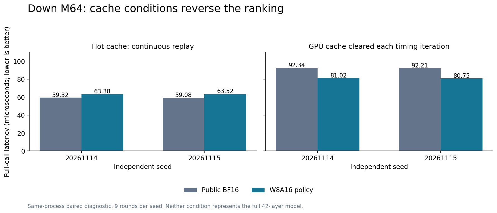

*图5：同seed、同provider、同一进程，不同缓存计时条件使方向反转。历史固定入口与当前入口在相同条件下接近，支持缓存口径是历史差异的主要解释；没有硬件命中率计数，不声称已证明所有模型阶段的成因。两种micro都不自动代表42层工作集；官方测评不能插入清缓存步骤。*

### 4.6 天数四投影和大M对照

以下为同场图重放完整调用；M64测量沿用逐次清GPU缓存的条件，不能作为热缓存或模型执行收益。负数表示量化耗时下降。

| 投影 | BF16 μs | 量化 μs | 延迟变化 |
|---|---:|---:|---:|
| Down | 92.939 | 80.892 | −12.96% |
| Gate/Up | 126.254 | 134.840 | +6.80% |
| QKV | 50.197 | 45.539 | −9.28% |
| O | 42.279 | 40.238 | −4.83% |

Down、QKV、O在各10轮配对中均更快，Gate/Up均更慢；M64并不能覆盖其他形状。大M实际运行入口的对照包含转换：Down M2048由571.458增至629.508 μs（+10.16%），M4096由1119.108增至1175.806 μs（+5.07%）。这些结果与前述冷热缓存复核共同说明，量化分界需依据完整路径和实际工作集验证。

### 4.7 KV量化消融：K保护与静态scale范围

固定四个通道可以在加载前确定布局，避免每步动态 top4 选择。但固定集合不会覆盖所有输入中的异常值，必须与静态 scale 的范围共同验证。单独验证“固定保护”或“静态 scale”通过，不能直接推出叠加方案通过。

早期类别留一探索复用 5/42 层的 90 份 RoPE 后张量，输出门槛预设为 max abs≤0.20、NRMSE≤0.05：

| 数值方案 | 通过数 | 最坏 max abs | 最坏 NRMSE |
|---|---:|---:|---:|
| V-only | 90/90 | 0.014343 | 0.005526 |
| 动态 top4 K | 90/90 | 0.035857 | 0.009889 |
| 固定保护＋静态 scale×1 折Q | 70/90 | 1.077113 | 0.407949 |
| 固定保护＋静态 scale×1.25 折Q | 83/90 | 0.575531 | 0.272919 |
| 固定保护＋静态 scale×2 折Q | 90/90 | 0.074521 | 0.031240 |
| 无保护静态 scale×2 折Q | 90/90 | 0.079243 | 0.042580 |

数据说明 margin 和保护的组合影响很大；最终沿用预定 margin=2。静态方案误差仍大于动态 top4，不以通过门槛掩盖这一取舍。该实验复用探索数据，不是 90 条独立文本盲测，更不是模型精度。

### 4.8 KV量化完整调用性能对照

最终融合确认 seed20261216，88例，9轮配对、每轮5次图重放。对照“原 V fresh”为重新测量的早期 V-only 固定实现，没有和静态方案联合重调所有参数。代表结果如下，单位ms：

| batch / KV长度 / Q长度 | 原 V fresh | 静态完整调用 | 耗时降低 |
|---|---:|---:|---:|
| 24 / 4096 / 1 | 0.325200 | 0.305521 | 6.05% |
| 56 / 4096 / 1 | 0.716922 | 0.678840 | 5.31% |
| 64 / 4096 / 1 | 0.825861 | 0.778603 | 5.72% |
| 72 / 4096 / 1 | 1.183555 | 0.840445 | 28.99% |
| 24 / 16384 / 1 | 1.196220 | 1.089767 | 8.90% |
| 64 / 16384 / 1 | 3.081095 | 2.928681 | 4.95% |
| 4 / 257 / 17 | 0.062165 | 0.041611 | 33.06% |
| 1 / 128 / 128 | 0.023425 | 0.027325 | −16.65% |
| 4 / 2048 / 512 | 1.002662 | 1.004367 | −0.17% |

4K 的35个标准capture尺寸均更快，耗时下降1.69%～38.20%；16K、batch≤64的11点下降2.55%～49.38%。这些是所测形状的完整算子结果，不等于模型请求分布或耗时覆盖。短KV和部分Prefill仍负收益，不能宣称所有输入均优于V-only；大幅改善同时含配置与分段差异，不能作为静态位宽本身的收益。

早期真实90快照的四种融合调用共360次与静态原型逐位相等，总误差90/90通过；但这组数据来自5/42层旧探索张量。生产fixture另有8例调用、字节与图增长检查，使用合成scale；两者均不能替代42层参数上的模型评测。

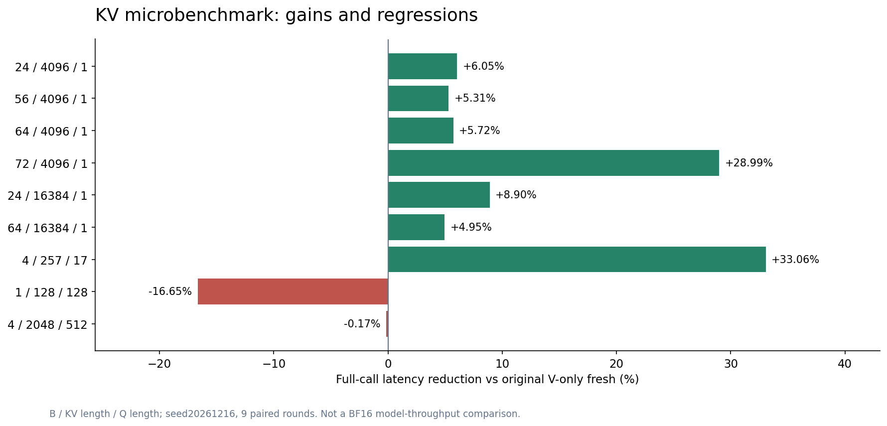

*图6：从本节原始耗时表直接计算，正值为耗时降低。分母为早期V-only固定对照，不是BF16模型基线；图中保留Q128、Q512 Prefill退化，选择的代表点不等于全输入覆盖。*

### 4.9 消融能够支持的结论与尚缺的对照

转换粒度实验固定其他阶段，联合配置实验固定转换与融合，能够支持各自完整调用的改善；保护与scale实验用于比较误差，不能代替吞吐消融。静态KV与早期V-only的比较同时包含配置和分段变化，收益属于整条被测链。

当前尚缺在最终相同配套优化底座上只关闭权重量化的模型对照，也缺静态KV最终版本的完整官方BF16性能对照。因此，下章沐曦总提升属于最终组合，静态KV仅报告已有精度与两轮诊断；不把有限对照拼接成完整的单因素归因。

## 5 模型总体测试结果与效果分析

### 5.1 算子正确性与实际接入验证

历史生产接口小M验证覆盖M1～113、两个seed共226条，最大相对L2约0.00169746，属于对应被测版本。最终M4096接入另以两个新seed对M2048/4096的四投影进行16项eager与图正确性检查，最大L2约0.001661356，全部通过。

M4096量化Down在独立搜索中的两个seed完整调用为564.33/564.43 μs，图重放为580.43/579.69 μs，包含转换和融合scale。其他投影BF16映射的接入复验也通过，但不将它们写成INT8计算收益。

### 5.2 沐曦最终组合的官方吞吐与时延

最终组合包括Down量化、其余投影的专用BF16配置，以及自适应Prefill预算和同步消除优化。对照为同容器、相同官方命令与统计逻辑补跑的默认BF16。

| 场景 | BF16 tok/s | 最终组合 tok/s | 吞吐提升 | BF16 TTFT ms | 组合TTFT ms | TTFT降低 |
|---|---:|---:|---:|---:|---:|---:|
| 4K | 5050.28 | 5668.66 | 12.24% | 3279.94 | 2111.42 | 35.63% |
| 16K | 6981.43 | 8675.61 | 24.27% | 27411.66 | 17018.61 | 37.91% |

两场景吞吐均有效提升，TTFT均有效改善。4K平均TPOT为54.08 ms，16K为106.94 ms；每轮请求分别256/256和128/128成功。以下列出全部候选轮次，首轮不计入最终平均。

| 场景 | 轮次 | tok/s | Mean TTFT ms |
|---|---:|---:|---:|
| 4K | 1 | 5594.35 | 2723.15 |
| 4K | 2 | 5670.10 | 2126.14 |
| 4K | 3 | 5671.42 | 2100.62 |
| 4K | 4 | 5664.47 | 2107.50 |
| 16K | 1 | 8158.85 | 17232.85 |
| 16K | 2 | 8678.66 | 17006.71 |
| 16K | 3 | 8676.07 | 17016.20 |
| 16K | 4 | 8672.09 | 17032.91 |

以上为组合总效果，尚不能将12.24%/24.27%全部归因于量化。历史默认BF16的4K结果较低，采用该历史分母会高估本组提升，因此主结论采用同容器新基线。

### 5.3 模型精度与输出行为

| 项目 | 沐曦最终组合 | 天数静态KV |
|---|---:|---:|
| 正确题数 | 102/105 | 101/105 |
| 准确率 | 0.9714 | 0.9619 |
| 请求成功 / API错误 | 105 / 0 | 105 / 0 |
| 正常停止 | 103 | 105 |
| 长度封顶 | 2 | 0 |
| 精度数值门槛 | 通过 | 通过 |

沐曦两条长度封顶输出均被评测器判对，仍保留为行为观察项；天数静态KV最大单题输出为28914 tokens。两者准确率均高于0.950，但单次随机生成不能证明量化提高能力，也不能把请求成功等同答案正确。静态KV的精度只覆盖该被测组合，不覆盖后续兼容或Down叠加版本。

### 5.4 天数静态KV模型性能诊断

| 场景 | 首轮 / 次轮 tok/s | 首轮 / 次轮 Mean TTFT ms |
|---|---|---|
| 4K | 2986.77 / 3243.05 | 5387.51 / 5105.03 |
| 16K | 2597.72 / 2842.64 | 88101.33 / 81062.23 |

该结果为两轮诊断，尚未完成四轮官方流程，不能以第二轮替代正式平均，也不据不同版本历史基线给出正式提升率。每token/head的KV格式由512字节降至276字节，仅说明46.09%的格式节省；不能直接换算成吞吐提升。

### 5.5 正式结果与诊断结果的适用范围

沐曦结果采用官方完整流程的第2、3、4轮平均，4K和16K均以同容器默认BF16作为对应基线。天数静态KV仅完成两轮诊断，不能取较快一轮当作正式结果。静态KV的独立算子对照是早期V-only实现，不是纯BF16 KV基线；其长上下文收益也包含分段配置变化，不能全部归因于量化位宽。

### 5.6 综合效果与局限

W8A16的有效优化集中在完整执行链：小M增加并行度，大M减少转换与输出往返，再根据新资源使用选择配置。静态KV将动态恢复工作转化为加载前确定的保护布局和当前Q变换，随后通过写入融合控制新增成本。两条路线均显示，位宽下降只有与计算组织匹配时才可能产生收益。

沐曦最终组合已有完整性能与精度结果；天数W8A16仍受缓存条件和大M成本限制，静态KV已有精度及部分算子收益，正式模型性能待补。未知Shape、其他模型与多卡并行需要独立验证，不将所测范围内较优描述为全局最优。

## 6 与其他优化的协同适配

### 6.1 沐曦自适应Prefill预算改变热点后的适配

自适应Prefill预算使16K场景每步处理规模发生变化。我们在相同量化底座上切换该优化，采集每模式Prefill 16个匹配step、Decode 128个匹配step，共八个窗口。

| 执行阶段 | 优化关闭时主要M | 优化开启时主要M |
|---|---:|---:|
| 4K Prefill/Mixed | 2048 | 2048 |
| 16K Prefill/Mixed | 2048 | 4096 |
| 4K与16K Decode | 64 | 64 |

开启后16K Prefill窗口中，M4096匹配GEMM占全部GPU Kernel时长约52.58%，其中普通BF16 MM约43.51%、Down MM与融合scale约8.59%、转换约0.47%。这使M4096配置复验成为量化适配的必要环节。该采样覆盖率只描述观察窗口，不代表所有未来输入。

我们对四个真实N/K分别执行216项候选搜索，共864项尝试；每组137项成功、79项失败。随后以独立seed、多轮交错完整调用和图重放复核。Down较优配置仍为128/128/128，完整调用约564 μs，确认已有范围策略可覆盖新热点；其余三个投影补充M4096的BF16配置，它们没有新增量化。

| 投影 | M2048分块 | M4096分块 |
|---|---|---|
| Down量化融合 | 128/128/128 | 128/128/128 |
| Gate/Up、QKV，BF16 | 128/128/64 | 128/128/64 |
| O，BF16 | 128/128/64 | 128/128/128 |

以上分块依次为BM/BN/BK，均采用4 warps、4 stages和异步复制流水线。该协同适配已进入前述最终组合验证。自适应预算与同步消除属于配套优化，其独立贡献不并入量化原创；总体收益也不能按各项独立百分比相加。

### 6.2 天数静态KV与Down叠加的组合观察

修正BF16提供者匹配后，先完成9个代表M的策略与正确性检查，再确认42层Down和35个图捕获尺寸，获得以下两轮诊断。

| 场景 | 首轮 / 次轮 tok/s | 首轮 / 次轮 TTFT ms | 次轮相对历史静态KV吞吐变化 |
|---|---|---|---:|
| 4K | 2805.45 / 3117.49 | 6091.17 / 5066.99 | −3.87% |
| 16K | 2331.43 / 2801.23 | 101403.69 / 79513.72 | −1.46% |

两组提供者和时间不同，不能将差值严格归因于Down；两轮也不构成完整官方结果。但现有数据没有支持扩大该组合的模型正收益，因此未进一步推进Down与QKV/O的组合。静态KV单独的101/105精度不能继承为该组合精度。

### 6.3 天数011至013与静态KV兼容

原#011 Mixed分相和#013紧凑Decode针对BF16/page16，静态KV则使用INT8/page32并覆写forward，直接合并不会自动获得相同执行路径。本次隔离原BF16 launcher与INT8数值修复，在原有MetadataBuilder利用CPU query前缀判定合法Decode前缀和Prefill后缀；每步先完成一次Q变换及真实KV写入，再分开执行Attention，物理缓存和scale保持同一份。单Query行满足资格时，将最终静态Kernel的序列查找改为直接索引并缩小网格，保护K恢复、V scale和归约逻辑不变；不支持的形状保留合法回退。#012 Sampling沿用原实现。42层校准和缓存格式未改变，W8A16关闭。

本地及远端CPU各14项通过；原#011～#013回归83/83通过；新增静态算子49/49通过，含缓存字节、Q变换及输入变化后的图重放。最大绝对误差3.05176e-5、NRMSE 0.00208302，小于预设0.08/0.02；合成scale算子测试不代替模型精度。完整micro仍有纯Decode约2.2%及小Prefill Mixed约37.65%的耗时退化，另外6个Mixed点耗时降低15.85%～52.71%，不把单点收益推广为全部形状。

组合服务完成42层参数加载和35个Decode图捕获，4K各256/256、16K各128/128请求成功。按用户指定，只展示第二轮比较：

| 场景 | 官方天数基线 tok/s | 组合第二轮 tok/s | 整体吞吐提升 | Mean TTFT ms |
|---|---:|---:|---:|---:|
| 4K | 2028.01 | 3575.78 | +76.32% | 4657.29 |
| 16K | 915.15 | 3062.64 | +234.66% | 74217.25 |

官方基线来自[归档记录](docs/optimization/evidence/2026-11-16-static-kv/s2final-baseline-record.md)。此提升包含s2final、#011～#013与KV的全部贡献，不能归为KV单项收益。相对原静态KV第二轮，本次吞吐分别高10.26%/7.74%，TTFT分别降低8.77%/8.44%；跨时间未配对，不能严格归因。第一轮全部保留，包括4K第一轮TTFT相对旧KV增加29.19%的负结果。

本次每场景仅两轮诊断，不能替代官方四轮后三轮平均；精度按用户要求未测，前述101/105属于原静态KV版本，不是兼容组合成绩。模型运行兼容性已有证据，完整性能与精度验收仍未完成。16K的KV使用率曾达99.8%，启动容量969856tokens，量化后仍可能满载。详细实现、边界及完整结果见[#020改动说明](docs/optimization/tianshu/kv/改动说明-020-BI-V150-静态KV与011至013兼容.md)。


上述实测属于兼容分支快照，整合分支的初始化、全源校验和配套FlagGems另有变化，整合版本身仍仅完成CPU验证，需在设备上复验。
